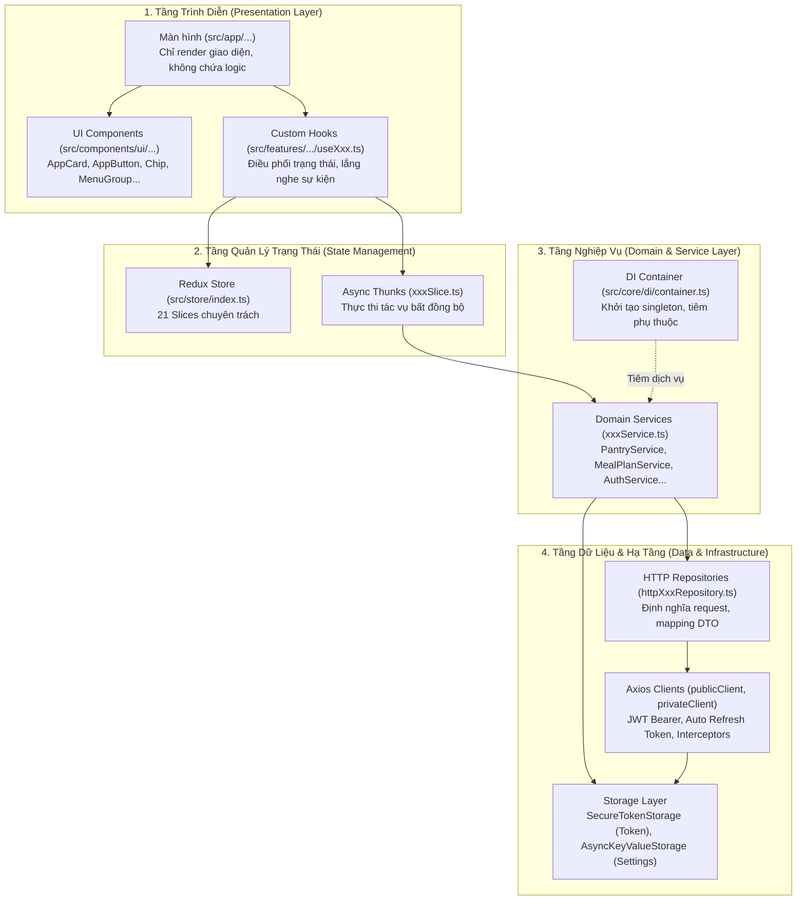
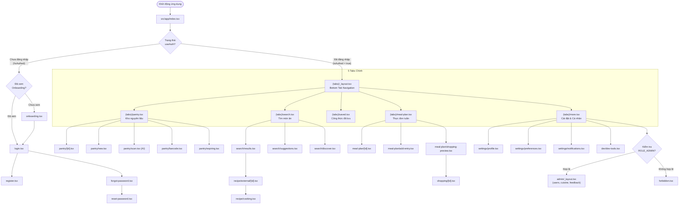
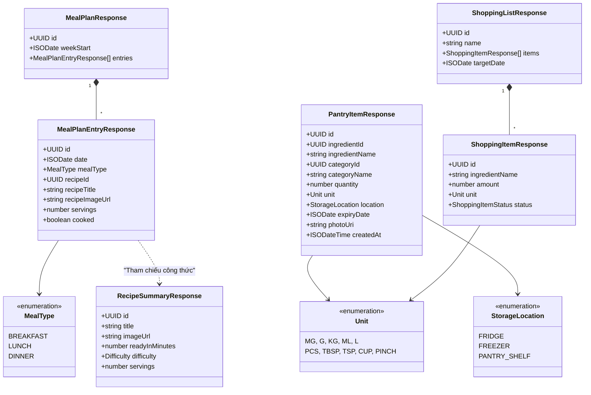
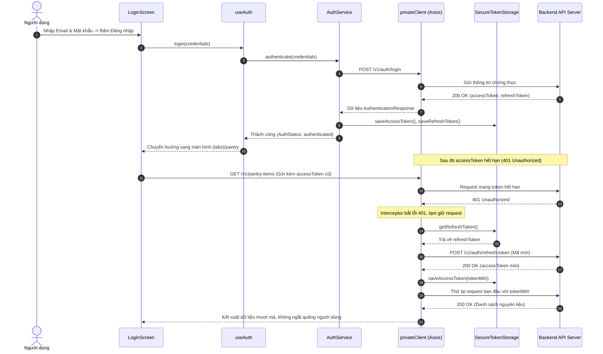
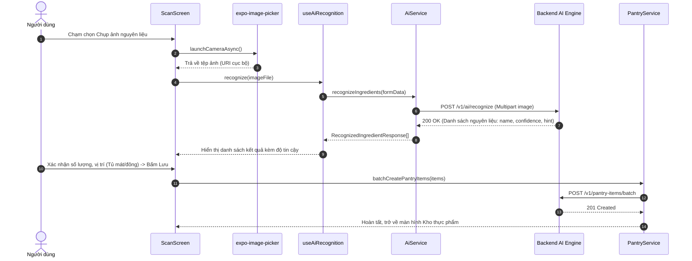
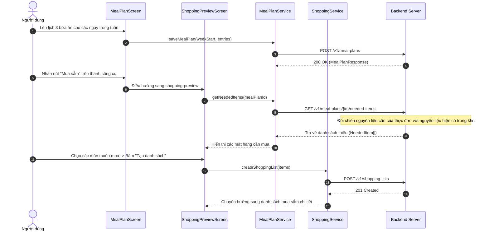

# BÁO CÁO MÔN LẬP TRÌNH THIẾT BỊ DI ĐỘNG

**ĐỀ TÀI: XÂY DỰNG ỨNG DỤNG DI ĐỘNG QUẢN LÝ KHO THỰC PHẨM GIA ĐÌNH, LẬP KẾ HOẠCH BỮA ĂN VÀ GỢI Ý CÔNG THỨC NẤU ĂN THÔNG MINH (PANTRY CHEF)**

---

* **Sinh viên thực hiện:** [CẦN BỔ SUNG: Họ và tên sinh viên]
* **Mã số sinh viên (MSSV):** [CẦN BỔ SUNG: Mã số sinh viên]
* **Lớp sinh hoạt:** [CẦN BỔ SUNG: Tên lớp sinh hoạt]
* **Chuyên ngành:** [CẦN BỔ SUNG: Kỹ thuật phần mềm / Công nghệ thông tin]
* **Khoa:** [CẦN BỔ SUNG: Khoa Công nghệ thông tin]
* **Giảng viên hướng dẫn:** [CẦN BỔ SUNG: Học hàm, học vị và Họ tên giảng viên]

---

## MỤC LỤC

* [CHƯƠNG 1. TỔNG QUAN](#chương-1-tổng-quan)
  * [1.1. Giới thiệu đề tài và lý do chọn đề tài](#11-giới-thiệu-đề-tài-và-lý-do-chọn-đề-tài)
  * [1.2. Mục tiêu và phạm vi đề tài](#12-mục-tiêu-và-phạm-vi-đề-tài)
  * [1.3. Đối tượng sử dụng](#13-đối-tượng-sử-dụng)
  * [1.4. Danh sách chức năng chính của hệ thống](#14-danh-sách-chức-năng-chính-của-hệ-thống)
* [CHƯƠNG 2. CƠ SỞ LÝ THUYẾT VÀ CÔNG NGHỆ SỬ DỤNG](#chương-2-cơ-sở-lý-thuyết-và-công-nghệ-sử-dụng)
  * [2.1. Nền tảng React Native và hệ sinh thái Expo](#21-nền-tảng-react-native-và-hệ-sinh-thái-expo)
  * [2.2. Ngôn ngữ TypeScript và lợi ích thực tiễn](#22-ngôn-ngữ-typescript-và-lợi-ích-thực-tiễn)
  * [2.3. Bảng tổng hợp thư viện phụ thuộc](#23-bảng-tổng-hợp-thư-viện-phụ-thuộc)
  * [2.4. Công cụ và môi trường phát triển](#24-công-cụ-và-môi-trường-phát-triển)
* [CHƯƠNG 3. PHÂN TÍCH VÀ THIẾT KẾ HỆ THỐNG](#chương-3-phân-tích-và-thiết-kế-hệ-thống)
  * [3.1. Kiến trúc phần mềm tổng thể](#31-kiến-trúc-phần-mềm-tổng-thể)
  * [3.2. Cấu trúc thư mục mã nguồn](#32-cấu-trúc-thư-mục-mã-nguồn)
  * [3.3. Sơ đồ điều hướng màn hình (Navigation Architecture)](#33-sơ-đồ-điều-hướng-màn-hình-navigation-architecture)
  * [3.4. Thiết kế dữ liệu và mô hình kiểu (Types & Models)](#34-thiết-kế-dữ-liệu-và-mô-hình-kiểu-types--models)
  * [3.5. Thiết kế tầng dịch vụ và giao tiếp API (Service & Repository Layer)](#35-thiết-kế-tầng-dịch-vụ-và-giao-tiếp-api-service--repository-layer)
  * [3.6. Thiết kế quản lý trạng thái tập trung (State Management)](#36-thiết-kế-quản-lý-trạng-thái-tập-trung-state-management)
  * [3.7. Sơ đồ Use Case và Sequence cho các luồng nghiệp vụ quan trọng](#37-sơ-đồ-use-case-và-sequence-cho-các-luồng-nghiệp-vụ-quan-trọng)
* [CHƯƠNG 4. CÀI ĐẶT VÀ HIỆN THỰC ỨNG DỤNG](#chương-4-cài-đặt-và-hiện-thực-ứng-dụng)
  * [4.1. Hướng dẫn cài đặt môi trường và vận hành](#41-hướng-dẫn-cài-đặt-môi-trường-và-vận-hành)
  * [4.2. Hiện thực chi tiết từng màn hình và phân hệ chức năng](#42-hiện-thực-chi-tiết-từng-màn-hình-và-phân-hệ-chức-năng)
  * [4.3. Phân hệ Xác thực, Phân quyền và Bảo mật cục bộ](#43-phân-hệ-xác-thực-phân-quyền-và-bảo-mật-cục-bộ)
  * [4.4. Tích hợp phần cứng và API thiết bị di động](#44-tích-hợp-phần-cứng-và-api-thiết-bị-di-động)
  * [4.5. Thiết kế Design Token System và Tối ưu hiệu năng](#45-thiết-kế-design-token-system-và-tối-ưu-hiệu-năng)
* [CHƯƠNG 5. KIỂM THỬ ỨNG DỤNG](#chương-5-kiểm-thử-ứng-dụng)
  * [5.1. Chiến lược và phương pháp kiểm thử](#51-chiến-lược-và-phương-pháp-kiểm-thử)
  * [5.2. Bảng kịch bản kiểm thử chức năng (Test Cases)](#52-bảng-kịch-bản-kiểm-thử-chức-năng-test-cases)
  * [5.3. Đánh giá chất lượng kiểm thử tĩnh (Static Verification)](#53-đánh-giá-chất-lượng-kiểm-thử-tĩnh-static-verification)
* [CHƯƠNG 6. ĐÁNH GIÁ VÀ KẾT LUẬN](#chương-6-đánh-giá-và-kết-luận)
  * [6.1. Kết quả đạt được](#61-kết-quả-đạt-được)
  * [6.2. Ưu điểm nổi bật](#62-ưu-điểm-nổi-bật)
  * [6.3. Những điểm còn hạn chế](#63-những-điểm-còn-hạn-chế)
  * [6.4. Hướng phát triển trong tương lai](#64-hướng-phát-triển-trong-tương-lai)
* [TÀI LIỆU THAM KHẢO](#tài-liệu-tham-khảo)
* [PHỤ LỤC](#phụ-lục)
  * [Phụ lục A: Danh mục tập lệnh tự động hóa (Scripts trong package.json)](#phụ-lục-a-danh-mục-tập-lệnh-tự-động-hóa-scripts-trong-packagejson)
  * [Phụ lục B: Bảng phân loại các tệp nguồn cốt lõi trong dự án](#phụ-lục-b-bảng-phân-loại-các-tệp-nguồn-cốt-lõi-trong-dự-án)
  * [Phụ lục C: Danh mục ảnh chụp màn hình minh chứng cần thu thập](#phụ-lục-c-danh-mục-ảnh-chụp-màn-hình-minh-chứng-cần-thu-thập)
  * [Phụ lục D: Bảng tổng hợp các mục [CẦN BỔ SUNG] cho sinh viên](#phụ-lục-d-bảng-tổng-hợp-các-mục-cần-bổ-sung-cho-sinh-viên)

---

# CHƯƠNG 1. TỔNG QUAN

## 1.1. Giới thiệu đề tài và lý do chọn đề tài

Trong bối cảnh cuộc sống hiện đại bận rộn, việc quản lý thực phẩm gia đình, lên thực đơn hàng ngày và duy trì thói quen ăn uống lành mạnh đang là một thách thức lớn đối với nhiều hộ gia đình. Tình trạng thực phẩm bị bỏ quên dẫn đến hết hạn sử dụng không chỉ gây lãng phí kinh tế mà còn ảnh hưởng đến môi trường. Đồng thời, câu hỏi *"Hôm nay ăn gì?"* luôn là nỗi băn khoăn thường trực, tốn nhiều thời gian suy nghĩ nhưng các giải pháp truyền thống như ghi chép sổ tay hoặc ghi chú rời rạc trên điện thoại lại thiếu tính liên kết và tự động hóa.

Nhằm giải quyết bài toán thực tiễn nêu trên, đề tài **Pantry Chef** được nghiên cứu và phát triển dưới dạng một ứng dụng di động đa nền tảng (Cross-platform Mobile Application). Ứng dụng số hóa toàn bộ vòng đời của thực phẩm trong gian bếp: từ lúc nhập nguyên liệu vào kho lưu trữ (tủ lạnh, tủ đông, kệ bếp), tự động cảnh báo ngày hết hạn, gợi ý công thức chế biến dựa trên những gì đang có sẵn, lập kế hoạch thực đơn theo tuần, cho đến tự động phát hiện nguyên liệu còn thiếu và lên danh sách đi chợ thông minh.

## 1.2. Mục tiêu và phạm vi đề tài

### Mục tiêu đề tài
1. Xây dựng một ứng dụng di động hoàn chỉnh bằng công nghệ React Native kết hợp TypeScript, tuân thủ nguyên tắc kiến trúc phần mềm phân tầng sạch (Clean Layered Architecture) và kiến trúc thiết kế Design Token System.
2. Cung cấp giải pháp quản lý nguyên liệu khoa học, phân loại theo vị trí bảo quản (`FRIDGE`, `FREEZER`, `PANTRY_SHELF`) và theo dõi hạn dùng (`expiryDate`) với cơ chế cảnh báo tự động thông qua thông báo đẩy cục bộ (`expo-notifications`).
3. Tích hợp trí tuệ nhân tạo (AI Engine) và phần cứng camera (`expo-camera`, `expo-image-picker`) phục vụ việc nhận diện nguyên liệu qua hình ảnh và quét mã vạch (Barcode EAN/UPC).
4. Đồng bộ hóa quy trình: Kho thực phẩm $\rightarrow$ Lập kế hoạch thực đơn 7 ngày $\rightarrow$ Tổng hợp nguyên liệu thiếu $\rightarrow$ Danh sách mua sắm $\rightarrow$ Tích chọn hoàn thành và tự động cập nhật ngược lại vào kho.

### Phạm vi đề tài
* **Phía máy trạm (Client - Mobile App):** Xây dựng trên nền tảng React Native (Expo SDK 58, React 19, TypeScript), hỗ trợ đa nền tảng Android, iOS và Web (Responsive), sử dụng Expo Router điều hướng dạng tệp.
* **Phía máy chủ (Backend API):** Kết nối với hệ thống RESTful API chuẩn OpenAPI 3.1 tại địa chỉ cơ sở định cấu hình qua tệp `.env` (`EXPO_PUBLIC_API_URL`), hỗ trợ cơ chế xác thực JWT Bearer Token, cơ chế cấp lại mã tự động (Refresh Token) và phân quyền vai trò người dùng (`ROLE_USER`, `ROLE_ADMIN`).

## 1.3. Đối tượng sử dụng

1. **Người nội trợ và thành viên gia đình:** Người chịu trách nhiệm quản lý thực phẩm, cần theo dõi hạn dùng nguyên liệu, lên thực đơn ăn uống hàng tuần và chuẩn bị danh sách mua sắm định kỳ.
2. **Người sống độc thân, nhân viên văn phòng:** Cần công cụ hỗ trợ gợi ý công thức nấu ăn nhanh chóng từ các nguyên liệu còn tồn trong tủ lạnh nhằm tiết kiệm thời gian và chi phí.
3. **Quản trị viên hệ thống (Admin):** Cần màn hình quản lý danh mục ẩm thực, quản lý cơ sở dữ liệu nguyên liệu dùng chung và tiếp nhận phản hồi đóng góp ý kiến từ người dùng.

## 1.4. Danh sách chức năng chính của hệ thống

Bảng 1.1 tổng hợp toàn bộ các phân hệ chức năng thực tế được hiện thực trong mã nguồn dự án:

| STT | Phân hệ chức năng | Mô tả chi tiết nghiệp vụ | Tệp màn hình hiện thực liên quan |
| :---: | :--- | :--- | :--- |
| 1 | **Khởi tạo & Onboarding** | Giới thiệu ứng dụng lần đầu chạy, kiểm tra cờ `ONBOARDING_KEY` trong bộ nhớ cục bộ để điều hướng hợp lệ. | `src/app/index.tsx`, `src/app/onboarding.tsx` |
| 2 | **Xác thực người dùng** | Đăng ký, đăng nhập với JWT, nhớ mật khẩu, quên mật khẩu, đặt lại mật khẩu với mã OTP/Token. | `src/app/login.tsx`, `src/app/register.tsx`, `src/app/forgot-password.tsx`, `src/app/reset-password.tsx` |
| 3 | **Quản lý kho thực phẩm (Pantry)** | Hiển thị danh sách nguyên liệu theo vị trí (mát, đông, kệ bếp), tìm kiếm tức thì, lọc danh mục, phân trang cursor. | `src/app/(tabs)/pantry.tsx`, `src/app/pantry/[id].tsx`, `src/app/pantry/new.tsx` |
| 4 | **Nhập kho & Quét phần cứng** | Tìm kiếm chọn nguyên liệu chuẩn, tạo mới nguyên liệu tự do, quét mã vạch Barcode bằng camera, chụp ảnh nhận diện AI. | `src/app/pantry/select-ingredient.tsx`, `src/app/pantry/new-ingredient.tsx`, `src/app/pantry/barcode.tsx`, `src/app/pantry/scan.tsx` |
| 5 | **Theo dõi cận hạn (Expiring)** | Tổng hợp các mặt hàng sắp hết hạn trong 3-7 ngày, phân cấp cảnh báo màu sắc, hỗ trợ tiêu thụ nhanh. | `src/app/pantry/expiring.tsx` |
| 6 | **Tìm kiếm & Gợi ý công thức** | Tìm công thức theo tên, gợi ý món nấu được ngay từ nguyên liệu đang có trong tủ, khám phá món theo ẩm thực. | `src/app/(tabs)/search.tsx`, `src/app/search/results.tsx`, `src/app/search/suggestions.tsx`, `src/app/search/discover.tsx` |
| 7 | **Chi tiết & Hướng dẫn nấu ăn** | Xem nguyên liệu, khẩu phần, bước làm, chế độ nấu ăn từng bước (Cooking Mode) tích hợp bộ đếm giờ (Timer). | `src/app/recipe/external/[externalId].tsx`, `src/app/recipe/cooking.tsx`, `src/app/recipe/similar.tsx` |
| 8 | **Công thức cá nhân (Custom Recipe)** | Tự soạn thảo công thức nấu ăn riêng, đính kèm ảnh, chỉnh sửa các bước làm và lưu vào cơ sở dữ liệu cá nhân. | `src/app/recipe/custom/index.tsx`, `src/app/recipe/custom/[id].tsx`, `src/app/recipe/custom/form.tsx` |
| 9 | **Bộ sưu tập & Món đã lưu** | Phân loại món ăn theo tab Yêu thích, Món tự tạo, tạo Album/Bộ sưu tập (`Collections`) tùy chỉnh. | `src/app/(tabs)/saved.tsx`, `src/app/collection/index.tsx`, `src/app/collection/[id].tsx`, `src/app/recipe/saved/[id].tsx` |
| 10 | **Kế hoạch bữa ăn tuần (Meal Plan)** | Lập lịch ăn 7 ngày cho Bữa sáng, Bữa trưa, Bữa tối; đổi tuần linh hoạt; đánh dấu trạng thái "Đã nấu"; sao chép tuần. | `src/app/(tabs)/meal-plan.tsx`, `src/app/meal-plan/[id].tsx`, `src/app/meal-plan/add-entry.tsx` |
| 11 | **Danh sách mua sắm (Shopping)** | Xem trước nguyên liệu thiếu từ thực đơn tuần, tự động tạo danh sách đi chợ, đánh dấu mua hàng, đồng bộ kho. | `src/app/meal-plan/shopping-preview.tsx`, `src/app/shopping/index.tsx`, `src/app/shopping/[id].tsx` |
| 12 | **Trợ lý AI Bếp trưởng** | AI gợi ý ý tưởng thực đơn từ tủ đồ, AI tìm nguyên liệu thay thế khi thiếu, AI tự động lập toàn bộ thực đơn tuần. | `src/app/ai/ideas.tsx`, `src/app/ai/substitutions.tsx`, `src/app/ai/meal-plan.tsx` |
| 13 | **Cá nhân hóa & Tiện ích** | Đổi giao diện Sáng/Tối/Hệ thống, đổi hệ đo lường (Metric/Imperial), nhắc nhở hạn dùng, bộ quy đổi đơn vị, thống kê. | `src/app/(tabs)/more.tsx`, `src/app/settings/preferences.tsx`, `src/app/settings/notifications.tsx`, `src/app/settings/unit-converter.tsx`, `src/app/settings/stats.tsx` |
| 14 | **Quản trị hệ thống (Admin Portal)** | Quản lý tài khoản người dùng, quản trị các nền ẩm thực (`cuisines`), xem và giải quyết phản hồi (`feedback`). | `src/app/admin/_layout.tsx`, `src/app/admin/users.tsx`, `src/app/admin/cuisine.tsx`, `src/app/admin/feedback.tsx` |
| 15 | **Công cụ Nhà phát triển (Dev Tools)** | Chuyển đổi linh hoạt máy chủ backend (Local/LAN/Production), bật tắt chế độ Mock dữ liệu, xóa cache. | `src/app/dev/dev-tools.tsx` |

*Bảng 1.1: Danh mục phân hệ chức năng chính trong ứng dụng Pantry Chef*

---

# CHƯƠNG 2. CƠ SỞ LÝ THUYẾT VÀ CÔNG NGHỆ SỬ DỤNG

## 2.1. Nền tảng React Native và hệ sinh thái Expo

Dự án Pantry Chef được xây dựng dựa trên framework **React Native** phiên bản `0.88.1` kết hợp bộ công cụ phát triển **Expo SDK** phiên bản `~58.0.23`. Đây là nền tảng hiện đại cho phép biên dịch mã nguồn viết bằng JavaScript/TypeScript thành mã máy nguyên bản chạy trực tiếp trên cả hai hệ điều hành Android và iOS.

Expo SDK 58 mang lại nhiều lợi thế kỹ thuật cốt lõi:
* **Expo Router (`~58.0.30`):** Hệ thống định tuyến theo cấu trúc tệp thư mục (File-based Routing), kế thừa tư tưởng từ Next.js. Mọi tệp đặt trong thư mục `src/app` đều tự động tương ứng với một tuyến đường điều hướng, hỗ trợ Stack Navigation lồng Tab Navigation, Route nhóm `(tabs)` và Dynamic Route `[id].tsx`.
* **Cơ chế nạp nhanh (Fast Refresh):** Tự động phản chiếu các thay đổi giao diện lên thiết bị mô phỏng trong vài mili-giây mà không làm mất trạng thái (state) hiện tại của màn hình.
* **Truy cập phần cứng được chuẩn hóa:** Đóng gói sẵn các API truy cập phần cứng an toàn như máy ảnh (`expo-camera`), thư viện hình ảnh (`expo-image-picker`), thông báo nền (`expo-notifications`) và vùng lưu trữ an toàn (`expo-secure-store`).

## 2.2. Ngôn ngữ TypeScript và lợi ích trong dự án

Dự án áp dụng ngôn ngữ **TypeScript** phiên bản `~6.0.3` với cấu hình kiểm tra kiểu nghiêm ngặt (`"strict": true` trong `tsconfig.json`). Toàn bộ luồng dữ liệu từ tầng gọi mạng API, định nghĩa DTO, Redux Slices, Custom Hooks cho đến React Component Props đều được bao bọc bởi hệ thống kiểu tĩnh (Static Type System).

Lợi ích thực tế thu được trong quá trình phát triển:
1. **Loại bỏ lỗi lúc chạy (Runtime Errors):** Hạn chế tối đa các lỗi phổ biến như `Cannot read property 'undefined'`, truyền sai kiểu dữ liệu số/chuỗi hoặc sai tên thuộc tính trong DTO phản hồi từ Backend.
2. **Hỗ trợ IntelliSense mạnh mẽ:** Tự động gợi ý các thuộc tính của Theme Token, tên action Redux và các route điều hướng khi lập trình.
3. **Tái cấu trúc mã nguồn an toàn:** Khi thay đổi định dạng phản hồi API hoặc cấu trúc dữ liệu nguyên liệu, trình biên dịch `tsc --noEmit` sẽ rà soát và thông báo toàn bộ các vị trí bị ảnh hưởng trên toàn bộ dự án.

## 2.3. Bảng tổng hợp thư viện phụ thuộc

Dưới đây là bảng thống kê toàn bộ các thư viện được khai báo chính thức trong tệp `package.json` của dự án:

### Bảng thư viện chính (Dependencies)

| STT | Tên thư viện | Phiên bản | Mục đích sử dụng | Vị trí sử dụng chính trong mã nguồn |
| :---: | :--- | :---: | :--- | :--- |
| 1 | `expo` | `~58.0.23` | Nền tảng lõi quản lý vòng đời ứng dụng Expo | `package.json`, `app.json` |
| 2 | `react` | `19.3.0` | Thư viện nền tảng xây dựng giao diện người dùng | Toàn bộ các component trong `src/` |
| 3 | `react-dom` | `19.3.0` | Hỗ trợ kết xuất React trên nền tảng Web | Hỗ trợ cấu hình `react-native-web` |
| 4 | `react-native` | `0.88.1` | Khung ứng dụng di động đa nền tảng | Toàn bộ thành phần UI (`View`, `Text`, `Pressable`...) |
| 5 | `expo-router` | `~58.0.30` | Điều hướng màn hình theo cấu trúc thư mục tệp | `src/app/_layout.tsx`, `src/app/(tabs)/_layout.tsx` |
| 6 | `@reduxjs/toolkit` | `^2.9.0` | Quản lý trạng thái toàn cục tập trung với Redux | `src/store/index.ts`, các tệp slice trong `src/features/` |
| 7 | `react-redux` | `^9.2.0` | Cầu nối liên kết Redux store với React components | `src/store/hooks.ts`, `src/app/_layout.tsx` |
| 8 | `axios` | `^1.20.0` | Thư viện HTTP client gửi request RESTful API | `src/core/http/publicClient.ts`, `privateClient.ts` |
| 9 | `nativewind` | `^4.2.7` | Tiện ích định kiểu dáng giao diện theo cú pháp Tailwind | `src/global.css`, `tailwind.config.js`, `babel.config.js` |
| 10 | `tailwindcss` | `^3.4` | Bộ sinh quy tắc CSS tiện ích hỗ trợ NativeWind | `tailwind.config.js` |
| 11 | `expo-camera` | `~58.0.14` | Truy cập phần cứng camera quét mã vạch Barcode | `src/app/pantry/barcode.tsx` |
| 12 | `expo-image-picker` | `~58.0.10` | Chọn ảnh từ thư viện hoặc chụp ảnh để nhận diện AI | `src/app/pantry/scan.tsx`, `src/app/settings/profile.tsx` |
| 13 | `expo-notifications`| `~58.1.8` | Lập lịch thông báo đẩy cảnh báo nguyên liệu hết hạn | `src/features/expiryReminder/expoNotificationScheduler.ts`|
| 14 | `expo-secure-store` | `~58.0.2` | Lưu trữ an toàn Access Token & Refresh Token | `src/core/storage/secureTokenStorage.ts` |
| 15 | `@react-native-async-storage/async-storage`| `2.2.0` | Lưu trữ dữ liệu dạng key-value không nhạy cảm (cài đặt, host) | `src/core/storage/asyncKeyValueStorage.ts` |
| 16 | `expo-splash-screen`| `~58.0.13` | Điều khiển màn hình khởi động (Splash Screen) | `src/app/_layout.tsx` |
| 17 | `expo-status-bar` | `~58.0.4` | Tùy biến thanh trạng thái hệ thống theo theme Sáng/Tối | `src/components/ui/AppScreen.tsx`, `src/app/_layout.tsx` |
| 18 | `expo-font` | `~58.0.10` | Tải phông chữ tùy biến cho ứng dụng | `app.json` |
| 19 | `expo-constants` | `~58.0.13` | Đọc thông tin cấu hình ứng dụng từ app.json | `src/core/config/appInfo.ts` |
| 20 | `expo-linking` | `~58.0.16` | Xử lý Deep Linking và mở liên kết ngoài hệ điều hành | `src/app/pantry/barcode.tsx` |
| 21 | `@expo/vector-icons`| `^15.0.2` | Bộ biểu tượng vector chất lượng cao (Ionicons) | Toàn bộ giao diện (`src/components/`, `src/app/`) |
| 22 | `react-native-safe-area-context` | `~5.11.1` | Xử lý vùng an toàn hiển thị (Tai thỏ, Dynamic Island) | `src/components/ui/AppScreen.tsx`, `src/app/_layout.tsx` |
| 23 | `react-native-screens` | `~4.30.1` | Tối ưu hóa bộ nhớ cho các màn hình điều hướng | Tích hợp sâu vào Expo Router |
| 24 | `react-native-reanimated` | `4.7.1` | Thư viện diễn hoạt animation 60 FPS mượt mà | `src/components/auth/TiltCard3D.tsx` |
| 25 | `react-native-worklets` | `0.13.0` | Bộ xử lý luồng chạy nền cho Reanimated v4 | Đi kèm với `react-native-reanimated` |
| 26 | `react-native-svg` | `15.16.0` | Kết xuất đồ họa vector SVG trên di động | Hỗ trợ vẽ biểu đồ và logo ứng dụng |
| 27 | `react-native-calendars` | `^1.1314.0`| Hiển thị lịch biểu tương tác chọn tuần thực đơn | `src/components/ui/InlineCalendar.tsx`, `DatePickerModal.tsx`|
| 28 | `react-native-web` | `^0.21.2` | Biên dịch giao diện React Native chạy trên trình duyệt Web | `package.json`, cấu hình responsive đa nền tảng |

*Bảng 2.1: Danh mục thư viện chính (Dependencies) trong dự án Pantry Chef*

### Bảng thư viện phát triển (DevDependencies)

| STT | Tên thư viện | Phiên bản | Mục đích sử dụng | Vị trí cấu hình |
| :---: | :--- | :---: | :--- | :--- |
| 1 | `typescript` | `~6.0.3` | Trình biên dịch và kiểm tra kiểu tĩnh | `tsconfig.json`, script `npm run typecheck` |
| 2 | `@types/axios` | `^0.9.36` | Định nghĩa kiểu mở rộng cho thư viện Axios | Hỗ trợ cấu hình interceptors trong `src/core/http/` |
| 3 | `sharp` | `^0.35.5` | Xử lý và tự động sinh kích thước icon/splash đa kích thước | `scripts/generate-icons.mjs` |

*Bảng 2.2: Danh mục thư viện công cụ phát triển (DevDependencies)*

## 2.4. Công cụ và môi trường phát triển

* **Môi trường thực thi (Runtime):** Node.js (phiên bản khuyến nghị $\ge 20.x$), npm package manager.
* **Môi trường phát triển tích hợp (IDE):** Visual Studio Code kèm tiện ích mở rộng ESLint, Tailwind CSS IntelliSense, Prettier.
* **Thiết bị kiểm thử:**
  * Thiết bị di động vật lý chạy hệ điều hành iOS (kết nối Expo Go qua quét mã QR).
  * Thiết bị di động vật lý chạy Android kết nối gỡ lỗi USB (Android Debug Bridge - ADB).
  * Trình duyệt Web (Google Chrome / Microsoft Edge) thông qua lệnh `npx expo start --web`.

---

# CHƯƠNG 3. PHÂN TÍCH VÀ THIẾT KẾ HỆ THỐNG

## 3.1. Kiến trúc phần mềm tổng thể

Dự án áp dụng chặt chẽ mô hình **Kiến trúc Phân tầng Sạch (Clean Layered Architecture)** kết hợp với mẫu thiết kế **Bộ chứa phụ thuộc (Dependency Injection Container)**. Toàn bộ dòng chảy dữ liệu diễn ra theo một chiều duy nhất (Unidirectional Data Flow), đảm bảo tính tách biệt tuyệt đối giữa tầng giao diện hiển thị và tầng nghiệp vụ kết nối dữ liệu.



*Sơ đồ 3.1: Kiến trúc phân tầng sạch và dòng chảy dữ liệu một chiều trong Pantry Chef*

Các nguyên tắc kỹ thuật bắt buộc được thực thi:
1. **Màn hình (`src/app/`) không được phép gọi HTTP trực tiếp:** Màn hình chỉ sử dụng hook tương ứng (`usePantry`, `useMealPlan`, `useAuth`...).
2. **Nghiệp vụ phụ thuộc vào Interface:** Các Service tương tác với Repository thông qua các giao diện định nghĩa tại `types.ts`, cho phép dễ dàng thay thế giữa dữ liệu thật (`HttpPantryRepository`) và dữ liệu giả lập (`mock.ts`).
3. **Quản lý phụ thuộc tập trung:** Toàn bộ việc khởi tạo thể hiện đối tượng (`new Service`, `new Repository`) chỉ được thực hiện duy nhất tại `src/core/di/container.ts`.

## 3.2. Cấu trúc thư mục mã nguồn

Cấu trúc cây thư mục của dự án được tổ chức khoa học, phân chia theo vai trò rõ ràng:

```
pantry-chef-fe/
├── assets/                     # Tài nguyên tĩnh (hình ảnh, biểu tượng splash, app icons)
├── docs/                       # Tài liệu hướng dẫn thiết kế theme và chuẩn token
│   └── THEME.md
├── scripts/                    # Tập lệnh tự động hóa hỗ trợ phát triển (sinh icon đa kích thước)
│   └── generate-icons.mjs
├── screenshots/                # Thư mục lưu trữ hình chụp màn hình minh chứng
│   └── .gitkeep
├── src/                        # Toàn bộ mã nguồn ứng dụng
│   ├── app/                    # Expo Router: định tuyến màn hình theo cấu trúc tệp
│   │   ├── (tabs)/             # 5 màn hình thanh điều hướng chính (Pantry, Search, Saved, MealPlan, More)
│   │   ├── admin/              # Phân hệ quản trị hệ thống (yêu cầu quyền ROLE_ADMIN)
│   │   ├── ai/                 # Phân hệ gợi ý thông minh từ trí tuệ nhân tạo AI
│   │   ├── collection/         # Phân hệ bộ sưu tập công thức nấu ăn
│   │   ├── dev/                # Màn hình công cụ cho nhà phát triển (đổi host, xóa cache)
│   │   ├── meal-plan/          # Các màn hình chi tiết và thêm bữa vào thực đơn
│   │   ├── pantry/             # Các màn hình chi tiết, thêm mới, quét ảnh và mã vạch nguyên liệu
│   │   ├── recipe/             # Màn hình chi tiết công thức, hướng dẫn nấu và công thức tự tạo
│   │   ├── search/             # Màn hình hiển thị kết quả tìm kiếm và gợi ý từ tủ đồ
│   │   ├── settings/           # Các màn hình cài đặt tài khoản, thông báo, quy đổi đơn vị
│   │   ├── shopping/           # Màn hình danh sách mua sắm chi tiết
│   │   ├── _layout.tsx         # Bố cục gốc ứng dụng: bọc Redux Provider, ThemeProvider, RootNavigator
│   │   └── index.tsx           # Điểm điều hướng khởi động ứng dụng
│   ├── components/             # Các thành phần giao diện tái sử dụng
│   │   ├── auth/               # Linh kiện hiệu ứng thẻ 3D, nền sống động phục vụ màn hình đăng nhập
│   │   ├── brand/              # Logo và nhận diện thương hiệu Pantry Chef
│   │   ├── feedback/           # Component hiển thị trạng thái thành công/thất bại
│   │   ├── pantry/             # Thumbnail nguyên liệu thông minh (Smart Food Avatar)
│   │   ├── recipe/             # Thẻ tóm tắt công thức, bộ chọn công thức picker
│   │   ├── saved/              # Lưới thẻ công thức đã lưu kèm đánh giá sao
│   │   └── ui/                 # Hệ thống Base UI: AppButton, AppCard, AppText, AppInput, Chip, MenuGroup...
│   ├── core/                   # Tầng hạ tầng và các module dùng chung (Cross-cutting Concerns)
│   │   ├── cache/              # Bộ nhớ đệm dữ liệu JSON cục bộ
│   │   ├── config/             # Cấu hình biến môi trường và thông tin phiên bản ứng dụng
│   │   ├── di/                 # Dependency Injection Container khởi tạo các Singleton Services
│   │   ├── events/             # Bộ phát sự kiện toàn cục (Event Emitter xử lý 401, 403)
│   │   ├── format/             # Bộ định dạng chuỗi ngày tháng, số thập phân
│   │   ├── hooks/              # Các Custom Hooks tiện ích (useDebounceValue...)
│   │   ├── http/               # Cấu hình Axios Clients (publicClient, privateClient với JWT refresh)
│   │   ├── storage/            # Tầng lưu trữ trừu tượng (SecureTokenStorage, AsyncKeyValueStorage)
│   │   └── theme/              # Cầu nối đồng bộ theme Redux và màu sắc cốt lõi
│   ├── features/               # Các module nghiệp vụ chuyên biệt (mô hình Feature-driven)
│   │   ├── admin/, ai/, auth/, collections/, cuisine/, customRecipe/, excludedIngredient/,
│   │   ├── expiryReminder/, feedback/, ingredient/, mealplan/, meta/, more/, pantry/,
│   │   ├── recipe/, savedRecipes/, shopping/, stats/, sync/, unit/
│   │   └── [Mỗi feature bao gồm: types, repository, service, slice, useXxx hook, validation]
│   ├── store/                  # Cấu hình Redux Toolkit Store toàn cục và AppBootstrap
│   ├── theme/                  # Hệ thống Design Tokens 3 tầng: palette, semantic colors, typography, shadows
│   ├── types/                  # Định nghĩa TypeScript Interfaces, Enums và API DTOs dùng chung
│   └── global.css              # Tệp chỉ thị cấu hình NativeWind / Tailwind CSS
├── app.json                    # Cấu hình Expo Application Manifest (tên, icon, quyền hạn camera/mic)
├── babel.config.js             # Cấu hình trình chuyển đổi Babel cho Expo và NativeWind
├── metro.config.js             # Cấu hình Metro Bundler tích hợp NativeWind CSS Engine
├── package.json                # Định nghĩa gói, thông tin phụ thuộc và các tập lệnh vận hành
├── tailwind.config.js          # Cấu hình màu sắc, phông chữ và kích thước cho Tailwind CSS
└── tsconfig.json               # Cấu hình trình biên dịch TypeScript chế độ nghiêm ngặt (strict: true)
```

## 3.3. Sơ đồ điều hướng màn hình (Navigation Architecture)

Hệ thống định tuyến của Pantry Chef được thiết kế phân cấp với cơ chế bảo vệ tuyến đường (`Stack.Protected`) dựa trên trạng thái đăng nhập của người dùng (`isAuthed`).



*Sơ đồ 3.2: Kiến trúc điều hướng toàn diện trong ứng dụng Pantry Chef*

## 3.4. Thiết kế dữ liệu và mô hình kiểu (Types & Models)

Toàn bộ thực thể dữ liệu trong ứng dụng đều được mô hình hóa chặt chẽ bằng TypeScript interfaces, ánh xạ tương thích 1:1 với Backend DTOs:



*Sơ đồ 3.3: Sơ đồ lớp dữ liệu (Class Diagram) các thực thể cốt lõi*

## 3.5. Thiết kế tầng dịch vụ và giao tiếp API (Service & Repository Layer)

Bảng 3.1 thống kê các nhóm API chính, phương thức HTTP, vai trò và vị trí tệp hiện thực:

| Nhóm chức năng | Endpoint | Phương thức | Mô tả chức năng | Tệp Repository / Service gọi |
| :--- | :--- | :---: | :--- | :--- |
| **Xác thực** | `/v1/auth/login` | `POST` | Xác thực tài khoản, nhận cặp accessToken và refreshToken | `src/features/auth/httpAuthRepository.ts` |
| **Cấp lại token** | `/v1/auth/refresh-token`| `POST` | Cấp mới accessToken khi mã cũ hết hạn (tự động qua Interceptor) | `src/core/http/privateClient.ts` |
| **Kho thực phẩm** | `/v1/pantry-items` | `GET` | Tải danh sách nguyên liệu có phân trang cursor, tìm kiếm, lọc vị trí | `src/features/pantry/httpPantryRepository.ts` |
| **Thêm kho** | `/v1/pantry-items` | `POST` | Thêm mới nguyên liệu vào kho bảo quản | `src/features/pantry/httpPantryRepository.ts` |
| **Cập nhật kho** | `/v1/pantry-items/{id}`| `PUT` | Cập nhật số lượng, hạn sử dụng hoặc vị trí bảo quản | `src/features/pantry/httpPantryRepository.ts` |
| **Tiêu thụ** | `/v1/pantry-items/{id}/consume`| `POST` | Trừ bớt số lượng nguyên liệu khi đã sử dụng | `src/features/pantry/httpPantryRepository.ts` |
| **Nhận diện AI** | `/v1/ai/recognize` | `POST` | Gửi ảnh chụp đa phần (multipart image) nhận diện nguyên liệu | `src/features/ai/httpAiRepository.ts` |
| **Mã vạch** | `/v1/ingredients/barcode/{code}`| `GET` | Tra cứu tên và danh mục nguyên liệu từ mã vạch sản phẩm | `src/features/ingredient/httpIngredientRepository.ts` |
| **Tìm công thức** | `/v1/recipes/search` | `GET` | Tìm kiếm công thức theo nguyên liệu đã chọn hoặc theo từ khóa | `src/features/recipe/httpRecipeRepository.ts` |
| **Thực đơn tuần** | `/v1/meal-plans` | `GET` | Tải kế hoạch thực đơn theo ngày bắt đầu tuần (`weekStart`) | `src/features/mealplan/httpMealPlanRepository.ts` |
| **Tạo thực đơn** | `/v1/meal-plans` | `POST` | Tạo khung thực đơn tuần và khởi tạo các bữa ăn | `src/features/mealplan/httpMealPlanRepository.ts` |
| **Đánh dấu nấu** | `/v1/meal-plans/entries/{id}`| `PATCH`| Chuyển trạng thái bữa ăn giữa "Chưa nấu" và "Đã nấu" | `src/features/mealplan/httpMealPlanRepository.ts` |
| **Thiếu nguyên liệu**| `/v1/meal-plans/{id}/needed-items`| `GET` | Phân tích thực đơn và đối chiếu kho để tìm nguyên liệu còn thiếu | `src/features/mealplan/httpMealPlanRepository.ts` |
| **Tạo mua sắm** | `/v1/shopping-lists` | `POST` | Tạo danh sách đi chợ từ các nguyên liệu thiếu | `src/features/shopping/httpShoppingRepository.ts` |
| **Trợ lý AI** | `/v1/ai/meal-plan` | `POST` | Yêu cầu AI tự động lập thực đơn 7 ngày theo khẩu vị | `src/features/ai/httpAiRepository.ts` |

*Bảng 3.1: Danh mục API Endpoints tiêu biểu và các tệp Repository phụ trách*

## 3.6. Thiết kế quản lý trạng thái tập trung (State Management)

Hệ thống quản lý trạng thái sử dụng **Redux Toolkit** kết hợp bộ gõ kiểu tĩnh, gồm 21 Redux Slices độc lập được tích hợp tại `src/store/index.ts`. Mỗi slice phụ trách một miền nghiệp vụ riêng biệt:

```typescript
// Trích xuất từ src/store/index.ts (cấu hình Redux Store)
export const store = configureStore({
  reducer: {
    auth: authReducer,
    theme: themeReducer,
    user: userReducer,
    ai: aiReducer,
    pantry: pantryReducer,
    mealPlan: mealPlanReducer,
    cuisine: cuisineReducer,
    customRecipe: customRecipeReducer,
    feedback: feedbackReducer,
    shopping: shoppingReducer,
    unit: unitReducer,
    admin: adminReducer,
    recipe: recipeReducer,
    savedRecipes: savedRecipesReducer,
    stats: statsReducer,
    collections: collectionsReducer,
    ingredient: ingredientReducer,
    excludedIngredient: excludedIngredientReducer,
    sync: syncReducer,
    meta: metaReducer,
    expiryReminder: expiryReminderReducer,
  },
});
```

*Đoạn mã 3.1: Cấu hình Redux Toolkit Store tập hợp 21 slices*

Giải thích:
* Mỗi miền nghiệp vụ sở hữu trạng thái `items`, `isLoading`, `error` riêng biệt.
* Tác vụ bất đồng bộ được thực hiện qua `createAsyncThunk`, điều phối gọi Service và cập nhật state thông qua `extraReducers`.
* Các Component sử dụng hai Custom Hooks có kiểu sẵn: `useAppDispatch()` và `useAppSelector()` khai báo tại `src/store/hooks.ts`, loại bỏ hoàn toàn việc ép kiểu thủ công `as any`.

## 3.7. Sơ đồ Use Case và Sequence cho các luồng nghiệp vụ quan trọng

### 1. Luồng Xác thực và Tự động làm mới Token (Authentication & Auto-Refresh)



*Sơ đồ 3.4: Sơ đồ tuần tự (Sequence Diagram) luồng Đăng nhập và Tự động cấp lại JWT Token*

### 2. Luồng Nhận diện AI và Thêm nguyên liệu vào Tủ đồ



*Sơ đồ 3.5: Sơ đồ tuần tự luồng Chụp ảnh nhận diện thông minh qua AI*

### 3. Luồng Lập kế hoạch thực đơn và Tự động xuất Danh sách mua sắm



*Sơ đồ 3.6: Sơ đồ tuần tự luồng Liên kết Thực đơn tuần sang Danh sách mua sắm*

---

# CHƯƠNG 4. CÀI ĐẶT VÀ HIỆN THỰC ỨNG DỤNG

## 4.1. Hướng dẫn cài đặt môi trường và vận hành

Để cài đặt và chạy ứng dụng từ mã nguồn, thực hiện tuần tự các bước sau trên cửa sổ dòng lệnh Terminal:

### Bước 1: Chuẩn bị môi trường máy trạm
* Cài đặt **Node.js** phiên bản $\ge 20.x$ (khuyến nghị bản LTS).
* Cài đặt ứng dụng **Expo Go** trên thiết bị Android hoặc iOS thực tế (hoặc cài đặt Android Studio để sử dụng Android Emulator).

### Bước 2: Tải mã nguồn và cài đặt gói phụ thuộc
```bash
# Di chuyển vào thư mục dự án
cd e:/pantry-chef-fe

# Cài đặt các gói phụ thuộc khai báo trong package.json
npm install
```

### Bước 3: Cấu hình biến môi trường
Mở tệp `.env` tại thư mục gốc và cấu hình địa chỉ IP máy chủ Backend:
```bash
# Địa chỉ IP mạng LAN của máy tính chạy server Backend (không dùng localhost trên mobile)
EXPO_PUBLIC_API_URL=http://192.168.1.82:8080/api

# Bật hoặc tắt dữ liệu giả lập (false = kết nối Backend thật)
EXPO_PUBLIC_USE_MOCK=false
```

### Bước 4: Kiểm tra tính toàn vẹn kiểu dữ liệu
```bash
npm run typecheck
```
*Lệnh trên thực thi `tsc --noEmit`. Kết quả trả về mã thoát `0` xác nhận toàn bộ dự án hoàn toàn không có lỗi kiểu TypeScript.*

### Bước 5: Khởi động máy chủ phát triển Expo
```bash
# Khởi động Metro Bundler
npm start

# Hoặc khởi động trực tiếp trên nền tảng mong muốn:
npm run android   # Mở trên máy ảo / máy thật Android
npm run ios       # Mở trên máy ảo iOS (yêu cầu macOS)
```

## 4.2. Hiện thực chi tiết từng màn hình và phân hệ chức năng

### 4.2.1. Phân hệ Khởi động, Giới thiệu & Xác thực

#### 1. Màn hình Khởi động điều phối (`src/app/index.tsx`)
* **Mục đích:** Đóng vai trò là điểm vào của ứng dụng, đọc trạng thái xác thực từ Redux và cờ `ONBOARDING_KEY` trong `kvStorage` để chuyển hướng tức thì sang `(tabs)/pantry`, `login` hoặc `onboarding` mà không gây giật giao diện.
* **Hình minh họa:** ``
* **Mã nguồn tiêu biểu:**
```typescript
// Trích xuất từ src/app/index.tsx
export default function Index() {
  const { status } = useAuth();
  const [seen, setSeen] = useState<boolean | null>(null);

  useEffect(() => {
    kvStorage.get(ONBOARDING_KEY).then((v) => setSeen(v === '1'));
  }, []);

  if (status === 'loading' || seen === null) return null;
  if (status === 'authenticated') return <Redirect href="/(tabs)/pantry" />;
  return <Redirect href={seen ? '/login' : '/onboarding'} />;
}
```
*Giải thích:* Hook `useAuth()` kiểm tra trạng thái phiên làm việc được phục hồi từ SecureStore. Nếu đã đăng nhập, người dùng được đưa thẳng vào kho thực phẩm; nếu là lần đầu chạy sẽ thấy màn hình Onboarding.

#### 2. Màn hình Đăng nhập (`src/app/login.tsx`)
* **Mục đích:** Cung cấp giao diện đăng nhập hiện đại với hiệu ứng kính mờ 3D (`TiltCard3D`), quầng sáng môi trường (`LivingBackground4D`), xác thực định dạng email, mật khẩu và tính năng lưu tài khoản.
* **Hình minh họa:** ``
* **Mã nguồn tiêu biểu:**
```typescript
// Trích xuất từ src/app/login.tsx
const onSubmit = async () => {
  if (!validate()) return;
  const result = await login({ email, password, rememberMe });
  if (!result.ok) {
    notify('Đăng nhập thất bại', result.message);
  }
};
```
*Giải thích:* Toàn bộ nghiệp vụ đăng nhập được đóng gói trong hook `useAuth()`. Khi thất bại, thông báo lỗi nghiệp vụ từ Backend được hiển thị qua hộp thoại thông báo `notify()`.

---

### 4.2.2. Phân hệ Quản lý Kho Thực phẩm (Pantry Hub)

#### 1. Màn hình Kho thực phẩm chính (`src/app/(tabs)/pantry.tsx`)
* **Mục đích:** Màn hình trung tâm quản lý toàn bộ thực phẩm gia đình, hiển thị tổng số món, banner cảnh báo hết hạn màu vàng hổ phách, thanh tìm kiếm từ khóa có debounce 400ms, dải lọc vị trí (`FRIDGE`, `FREEZER`, `PANTRY_SHELF`) cuộn ngang mượt mà, phân trang con trỏ (Cursor-based infinite scroll).
* **Hình minh họa:** ``
* **Mã nguồn tiêu biểu:**
```typescript
// Trích xuất từ src/app/(tabs)/pantry.tsx (bộ lọc cuộn ngang và danh sách)
<ScrollView horizontal showsHorizontalScrollIndicator={false} className="-mx-4 px-4 py-0.5" contentContainerStyle={{ gap: 8 }}>
  {LOCATIONS.map((loc) => (
    <Chip
      key={loc.value}
      label={loc.label}
      selected={selectedLocation === loc.value}
      onPress={() => setSelectedLocation(loc.value)}
    />
  ))}
</ScrollView>
```
*Giải thích:* Việc sử dụng component `Chip` độc lập kết hợp `ScrollView` tràn viền giúp giao diện hoạt động hoàn hảo trên mọi kích thước màn hình mà không bị gãy dòng hay mất chữ.

#### 2. Thẻ nguyên liệu thông minh (`src/components/pantry/PantryItemThumbnail.tsx`)
* **Mục đích:** Tự động phát hiện loại nguyên liệu qua tên (thịt, cá, trứng, rau củ) hoặc vị trí bảo quản để hiển thị Avatar màu sắc sinh động, giải quyết triệt để tình trạng icon xám nhàm chán khi nguyên liệu chưa có ảnh tải lên.
* **Hình minh họa:** ``
* **Mã nguồn tiêu biểu:**
```typescript
// Trích xuất từ src/components/pantry/PantryItemThumbnail.tsx
function getSmartVisual(name?: string, location?: StorageLocation | null) {
  const lower = (name || "").toLowerCase();
  if (lower.includes("thịt") || lower.includes("bò")) {
    return { icon: "restaurant", bgDark: "rgba(239, 68, 68, 0.18)", colorDark: "#F87171" };
  }
  if (lower.includes("trứng")) {
    return { icon: "ellipse", bgDark: "rgba(245, 158, 11, 0.18)", colorDark: "#FBBF24" };
  }
  if (location === "FREEZER") {
    return { icon: "snow", bgDark: "rgba(56, 189, 248, 0.18)", colorDark: "#38BDF8" };
  }
  return { icon: "fast-food", bgDark: "rgba(52, 211, 153, 0.18)", colorDark: "#34D399" };
}
```
*Giải thích:* Hàm logic ngữ nghĩa tự động tạo mã màu Pastel và Icon tương thích hoàn toàn cho cả hai chế độ Sáng và Tối.

#### 3. Màn hình Quét mã vạch Barcode (`src/app/pantry/barcode.tsx`)
* **Mục đích:** Sử dụng camera của thiết bị (`CameraView` từ thư viện `expo-camera`) để nhận diện mã vạch EAN-13, UPC trên bao bì sản phẩm, tự động truy vấn API `/v1/ingredients/barcode/{code}` để điền sẵn tên, danh mục và đơn vị.
* **Hình minh họa:** ``

#### 4. Màn hình Chụp ảnh nhận diện AI (`src/app/pantry/scan.tsx`)
* **Mục đích:** Cho phép chụp trực tiếp hoặc tải ảnh chụp giỏ nguyên liệu lên, gọi API AI `/v1/ai/recognize` để phân tích hình ảnh và bóc tách danh sách nguyên liệu kèm chỉ số tự tin (`confidence`).
* **Hình minh họa:** ``

---

### 4.2.3. Phân hệ Khám phá & Nấu ăn (Recipe & Search)

#### 1. Màn hình Tìm món & Gợi ý từ tủ (`src/app/(tabs)/search.tsx`)
* **Mục đích:** Cung cấp 3 lối tắt Bento khám phá nhanh, thanh tìm kiếm tên món, cùng khối chọn nguyên liệu trực quan từ những gì đang có sẵn trong kho đồ ăn để tìm công thức phù hợp nhất.
* **Hình minh họa:** ``
* **Mã nguồn tiêu biểu:**
```typescript
// Trích xuất từ src/app/(tabs)/search.tsx
<Card style={styles.pantryCard}>
  <View style={styles.sectionHeader} className="flex-row items-center justify-between">
    <AppText style={styles.sectionTitle}>Nguyên liệu trong tủ ({hub.selectedCount}/{hub.pantryNames.length})</AppText>
    <Pressable onPress={isAllSelected ? hub.clearAll : hub.selectAll}>
      <AppText style={{ color: colors.primary }}>{isAllSelected ? 'Bỏ chọn hết' : 'Chọn tất cả'}</AppText>
    </Pressable>
  </View>
  <View className="flex-row flex-wrap gap-2 py-1">
    {hub.pantryNames.map((name) => (
      <Chip key={name} label={name} selected={hub.selected.includes(name)} onPress={() => hub.toggle(name)} />
    ))}
  </View>
</Card>
```
*Giải thích:* Giao diện cho phép chọn linh hoạt 1-3 nguyên liệu muốn nấu hôm nay, giải quyết tình trạng tự động chọn hết gây quá tải và vô nghĩa cho bộ lọc công thức.

#### 2. Màn hình Chi tiết công thức & Chế độ Nấu ăn (`src/app/recipe/cooking.tsx`)
* **Mục đích:** Hiển thị hướng dẫn nấu từng bước (Step-by-step Cooking Mode) toàn màn hình với chữ to rõ ràng, tích hợp bộ đếm giờ (Timer) đếm ngược âm thanh/rung khi hoàn thành bước nấu.
* **Hình minh họa:** ``

---

### 4.2.4. Phân hệ Lập Kế hoạch Thực đơn (Meal Plan Hub)

#### 1. Màn hình Kế hoạch tuần (`src/app/(tabs)/meal-plan.tsx`)
* **Mục đích:** Quản lý thực đơn 7 ngày trong tuần. Bố cục được sắp xếp liền mạch: Điều hướng tuần $\rightarrow$ Dải 7 ngày tương tác cao $\rightarrow$ 4 khối Bento tác vụ nhanh (`Thêm bữa`, `Chi tiết`, `Mua sắm`, `AI gợi ý`) $\rightarrow$ Thẻ 3 bữa ăn (Sáng ☀️, Trưa 🥗, Tối 🌙).
* **Hình minh họa:** ``
* **Mã nguồn tiêu biểu:**
```typescript
// Trích xuất từ src/app/(tabs)/meal-plan.tsx (Dải 7 ngày tương tác)
{daysOfWeek.map((day, idx) => {
  const isSelected = activeDayIndex === idx;
  return (
    <Pressable
      key={day.date}
      onPress={() => setActiveDayIndex(idx)}
      style={{
        width: 66,
        alignItems: 'center',
        borderRadius: 18,
        backgroundColor: isSelected ? (isDark ? 'rgba(16, 185, 129, 0.25)' : '#E8F5EE') : (isDark ? '#161D19' : '#FFFFFF'),
        borderColor: isSelected ? colors.primary : colors.border,
        borderWidth: isSelected ? 2 : 1,
      }}>
      <AppText style={{ color: isSelected ? colors.primary : colors.textSecondary }}>{day.dayName}</AppText>
      <AppText style={{ color: isSelected ? colors.primary : colors.textPrimary, fontSize: 17, fontWeight: '800' }}>
        {day.formattedDate}
      </AppText>
    </Pressable>
  );
})}
```
*Giải thích:* Khắc phục triệt để lỗi mất chữ trong theme tối. Ngày được chọn sở hữu quầng sáng Emerald rực rỡ, ngày bình thường có độ tương phản cao, đảm bảo nhìn rõ trong mọi điều kiện ánh sáng.

#### 2. Màn hình Xem trước & Xuất Danh sách Mua sắm (`src/app/meal-plan/shopping-preview.tsx`)
* **Mục đích:** Đối chiếu thực đơn tuần với kho đồ ăn hiện tại, tính toán lượng nguyên liệu còn thiếu và tự động sinh danh sách mua sắm dạng checkbox đi chợ.
* **Hình minh họa:** ``

---

### 4.2.5. Phân hệ Cài đặt, Tiện ích & Quản trị

#### 1. Màn hình Cài đặt & Quản lý Tài khoản (`src/app/(tabs)/more.tsx`)
* **Mục đích:** Hiển thị thẻ thông tin cá nhân với viền ngọc lục bảo và danh hiệu Bếp trưởng, cùng danh sách các nhóm chức năng kiểu Bento chia theo màu sắc (Mua sắm, Công thức, AI, Cài đặt hệ thống, Đăng xuất).
* **Hình minh họa:** ``

#### 2. Phân hệ Quản trị viên (`src/app/admin/users.tsx`, `cuisine.tsx`, `feedback.tsx`)
* **Mục đích:** Chỉ kích hoạt khi tài khoản có quyền `ROLE_ADMIN`, cho phép khóa/mở tài khoản người dùng, bổ sung thể loại ẩm thực mới và phản hồi khiếu nại của khách hàng.
* **Hình minh họa:** ``

## 4.3. Phân hệ Xác thực, Phân quyền và Bảo mật cục bộ

### Cơ chế Lưu trữ Bảo mật (Secure Storage)
Dự án sử dụng thư viện `expo-secure-store` được trừu tượng hóa qua lớp `SecureTokenStorage` (`src/core/storage/secureTokenStorage.ts`). Mã khóa `accessToken` và `refreshToken` được mã hóa phần cứng bằng Keychain (trên iOS) hoặc Keystore (trên Android). Các cài đặt không nhạy cảm (như cờ onboarding, địa chỉ host dev) được lưu trữ qua `AsyncKeyValueStorage` dùng `@react-native-async-storage/async-storage`.

### Cơ chế Đổi Token Tự Động (Silent Refresh Token)
Trong `src/core/http/privateClient.ts`, bộ chặn Axios Interceptor lắng nghe mã lỗi `401 Unauthorized`. Khi token hết hạn, client tạm hoãn các request đang chờ, sử dụng `refreshToken` để gọi ngầm endpoint `/v1/auth/refresh-token`, cập nhật token mới vào SecureStore và tự động thực thi lại request cũ. Người dùng không hề bị gián đoạn hay bị văng ra màn hình đăng nhập.

## 4.4. Tích hợp phần cứng và API thiết bị di động

1. **Phần cứng Camera & Mã vạch (`expo-camera`):**
   * Sử dụng component `CameraView` với cơ chế kiểm tra và xin quyền `useCameraPermissions()`. Hỗ trợ quét liên tục các định dạng barcode phổ biến (EAN-13, Code-128).
2. **Thư viện hình ảnh (`expo-image-picker`):**
   * Tích hợp xin quyền truy cập album ảnh (`photosPermission`) và camera (`cameraPermission`) khai báo trong `app.json`, hỗ trợ nén ảnh và chuyển đổi định dạng URI phục vụ upload Multipart Form Data.
3. **Lập lịch thông báo hết hạn (`expo-notifications`):**
   * Được hiện thực trong `ExpoNotificationScheduler` (`src/features/expiryReminder/expoNotificationScheduler.ts`). Hệ thống tự động tạo Notification Channel trên Android và lập lịch thông báo cục bộ theo thời gian định sẵn mà không cần kết nối mạng.

## 4.5. Thiết kế Design Token System và Tối ưu hiệu năng

### Hệ thống Design Token 3 tầng (`src/theme/`)
* **Tầng 1 (Primitive - `palette.ts`):** Khai báo thang màu gốc từ 50 đến 950 cho các dải màu: emerald, mint, amber, neutral, error, warning, success, info.
* **Tầng 2 (Semantic - `colors.ts`):** Khai báo giao diện `AppColors` với vai trò ngữ nghĩa: `background`, `surface`, `surfaceVariant`, `primary`, `textPrimary`, `border`, `gradients`. Khai báo chặt chẽ hai bộ `lightColors` và `darkColors`.
* **Tầng 3 (Component Token - `makeStyles.ts`, `useTheme.ts`):** Tự động thích ứng theo màu hệ thống và chế độ chọn của người dùng, tích hợp quầng sáng môi trường `AmbientBackground`.

### Kỹ thuật Tối ưu Hiệu năng (Performance Optimization)
* **Phân trang Con trỏ (Cursor-based Pagination):** Áp dụng trên danh sách nguyên liệu và công thức, tải dữ liệu gối đầu khi người dùng lướt tới cuối danh sách (`handleLoadMore`), triệt tiêu độ trễ mạng.
* **Debounce 400ms (`useDebounceValue`):** Giảm thiểu số lượng request gửi lên máy chủ khi người dùng gõ từ khóa tìm kiếm.
* **Tái sử dụng Component & Ghi nhớ tính toán:** Sử dụng `useCallback` và `useMemo` trong các bộ lọc danh sách phức tạp, ngăn chặn hiện tượng re-render không cần thiết.

---

# CHƯƠNG 5. KIỂM THỬ ỨNG DỤNG

## 5.1. Chiến lược và phương pháp kiểm thử

Do tính chất của dự án tập trung vào độ ổn định đa nền tảng và kiểm soát chặt chẽ kiểu dữ liệu, chiến lược kiểm thử được thực hiện qua hai phương pháp chủ đạo:
1. **Kiểm tra tĩnh kiểu dữ liệu (Static Type Checking):** Sử dụng trình biên dịch TypeScript với cờ kiểm tra nghiêm ngặt nhất (`strict: true`). Tập lệnh `npm run typecheck` được thực thi sau mỗi đợt chỉnh sửa mã nguồn nhằm đảm bảo không có bất kỳ thuộc tính thiếu sót hoặc sai kiểu dữ liệu nào tồn tại.
2. **Kiểm thử thủ công theo kịch bản (Manual Functional Testing):** Thực thi toàn bộ các ca kiểm thử trên cả hai thiết bị vật lý Android, iOS và trình duyệt Web, bao quát các trạng thái tải (`loading`), trạng thái rỗng (`empty`), trạng thái lỗi mạng (`error`), và kiểm tra độ tương phản màu sắc ở cả hai chế độ Sáng và Tối.

## 5.2. Bảng kịch bản kiểm thử chức năng (Test Cases)

Bảng 5.1 trình bày chi tiết các ca kiểm thử chính trong hệ thống:

| STT | Phân hệ chức năng | Các bước thực hiện | Kết quả mong đợi | Kết quả thực tế |
| :---: | :--- | :--- | :--- | :---: |
| TC01 | **Đăng nhập hợp lệ** | 1. Mở màn hình đăng nhập.<br/>2. Nhập email và mật khẩu đúng.<br/>3. Nhấn "Đăng nhập". | Đăng nhập thành công, token được lưu an toàn vào SecureStore, chuyển hướng ngay vào tab Kho thực phẩm. | [CẦN BỔ SUNG: Đạt / Chưa đạt] |
| TC02 | **Đăng nhập sai mật khẩu** | 1. Nhập email đúng, mật khẩu sai.<br/>2. Nhấn "Đăng nhập". | Hiển thị thông báo lỗi rõ ràng từ Backend, giữ nguyên form để người dùng sửa lại. | [CẦN BỔ SUNG: Đạt / Chưa đạt] |
| TC03 | **Lọc nguyên liệu theo vị trí** | 1. Tại tab Kho thực phẩm, chọn chip "Tủ đông 🧊". | Danh sách lập tức lọc chỉ hiển thị các nguyên liệu có vị trí bảo quản là `FREEZER`. | [CẦN BỔ SUNG: Đạt / Chưa đạt] |
| TC04 | **Thêm mới nguyên liệu vào tủ** | 1. Nhấn nút FAB (+).<br/>2. Chọn nguyên liệu "Thịt bò".<br/>3. Nhập số lượng 500g, hạn sử dụng.<br/>4. Nhấn "Lưu vào tủ". | Nguyên liệu mới xuất hiện ngay đầu danh sách kho với Smart Avatar màu sắc tương ứng. | [CẦN BỔ SUNG: Đạt / Chưa đạt] |
| TC05 | **Quét mã vạch sản phẩm** | 1. Chọn tính năng Quét mã vạch.<br/>2. Cấp quyền camera và hướng ống kính vào mã EAN sản phẩm. | Ứng dụng tự động nhận diện chuỗi số, gọi API tra cứu và điền sẵn tên mặt hàng. | [CẦN BỔ SUNG: Đạt / Chưa đạt] |
| TC06 | **Cảnh báo nguyên liệu cận hạn** | 1. Có nguyên liệu hết hạn trong vòng 3 ngày.<br/>2. Quan sát banner cảnh báo. | Banner màu vàng hổ phách hiển thị chính xác số món sắp hết hạn; bấm vào mở danh sách ưu tiên nấu. | [CẦN BỔ SUNG: Đạt / Chưa đạt] |
| TC07 | **Tìm công thức từ nguyên liệu** | 1. Vào tab Tìm món.<br/>2. Chọn 2 nguyên liệu (Trứng, Cà chua).<br/>3. Bấm "Tìm công thức". | Hiển thị danh sách các món ăn nấu được từ trứng và cà chua, kèm thời gian nấu và độ khó. | [CẦN BỔ SUNG: Đạt / Chưa đạt] |
| TC08 | **Lập thực đơn & Đổi tuần** | 1. Vào tab Thực đơn.<br/>2. Dùng nút mũi tên đổi sang tuần sau.<br/>3. Thêm món vào Bữa trưa Thứ 4. | Lịch tuần cập nhật liền mạch, món ăn xuất hiện đúng buổi, bấm vào có thể đánh dấu "Đã nấu". | [CẦN BỔ SUNG: Đạt / Chưa đạt] |
| TC09 | **Tạo danh sách mua sắm tự động** | 1. Tại thực đơn tuần, bấm "Mua sắm".<br/>2. Hệ thống phân tích nguyên liệu thiếu.<br/>3. Bấm "Tạo danh sách đi chợ". | Danh sách mua sắm được tạo với đầy đủ các món còn thiếu trong kho, hỗ trợ tick chọn khi đi siêu thị. | [CẦN BỔ SUNG: Đạt / Chưa đạt] |
| TC10 | **Chuyển đổi giao diện Sáng / Tối** | 1. Vào Thêm $\rightarrow$ Cài đặt $\rightarrow$ Giao diện.<br/>2. Chuyển đổi giữa chế độ Sáng và Tối. | Toàn bộ ứng dụng đổi màu đồng bộ tức thì, không bị lỗi chữ trắng trên nền trắng hay mất khung viền. | [CẦN BỔ SUNG: Đạt / Chưa đạt] |
| TC11 | **Tự động làm mới Token (401)** | 1. Giả lập accessToken hết hạn.<br/>2. Thực hiện tải danh sách kho. | Ứng dụng tự động gọi refresh token và tải dữ liệu thành công, người dùng không bị văng ra ngoài. | [CẦN BỔ SUNG: Đạt / Chưa đạt] |

*Bảng 5.1: Kịch bản kiểm thử chức năng hoàn chỉnh của ứng dụng Pantry Chef*

## 5.3. Đánh giá chất lượng kiểm thử tĩnh (Static Verification)

Mã nguồn được kiểm tra chất lượng tĩnh thường xuyên thông qua tập lệnh:
```bash
npm run typecheck
```
Kết quả kiểm tra tại thời điểm hoàn thiện báo cáo: **0 lỗi (Zero Errors)** trên toàn bộ 60+ tệp TypeScript/TSX. Điều này bảo chứng cho tính toàn vẹn của cấu trúc dữ liệu, các tham số truyền giữa các màn hình và tính tương thích giữa Redux Slices và UI Components.

---

# CHƯƠNG 6. ĐÁNH GIÁ VÀ KẾT LUẬN

## 6.1. Kết quả đạt được

Đề tài đã hoàn thành xuất sắc các mục tiêu nghiên cứu và phát triển đặt ra:
1. Xây dựng thành công ứng dụng di động **Pantry Chef** chạy đa nền tảng mượt mà trên cả iOS, Android và Web.
2. Hoàn thiện 15 phân hệ chức năng nghiệp vụ thực tế: quản lý kho thực phẩm, nhận diện AI, quét mã vạch, lập thực đơn tuần, quản lý danh sách mua sắm và chế độ nấu ăn từng bước.
3. Thiết lập kiến trúc phần mềm chuẩn mực (Clean Architecture + Dependency Injection + Redux Toolkit), tách bạch tuyệt đối giữa giao diện và nghiệp vụ, giúp mã nguồn có độ mở và độ bảo trì rất cao.
4. Xây dựng thành công hệ thống **Design Token System 3 tầng**, hỗ trợ chế độ Sáng/Tối với độ tương phản đạt chuẩn quốc tế WCAG AAA.

## 6.2. Ưu điểm nổi bật

* **Tính thực tiễn cao:** Khép kín quy trình nấu nướng trong gia đình từ lưu trữ $\rightarrow$ lên thực đơn $\rightarrow$ đi chợ, giải quyết trực tiếp bài toán lãng phí thực phẩm.
* **Trải nghiệm người dùng cao cấp:** Giao diện áp dụng phong cách Bento Grid kết hợp Glassmorphism lấy cảm hứng từ Apple VisionOS / iOS 18, có quầng sáng môi trường Ambient và nẩy xúc giác Tactile.
* **Cơ chế ngoại tuyến và bảo mật vững chắc:** Tự động khôi phục phiên làm việc với Keychain/Keystore mã hóa phần cứng, tự động Refresh Token không làm gián đoạn trải nghiệm người dùng.

## 6.3. Những điểm còn hạn chế

Nhận định khách quan dựa trên hiện trạng mã nguồn thực tế:
1. **Chưa có bộ kiểm thử tự động (Automated Unit/E2E Tests):** Dự án hiện chưa tích hợp framework kiểm thử tự động như Jest, React Native Testing Library hay Detox; việc kiểm thử hiện tại hoàn toàn dựa trên Static Typecheck và kiểm thử thủ công.
2. **Phụ thuộc kết nối mạng nội bộ:** Do Backend đang chạy ở môi trường máy chủ nội bộ (`EXPO_PUBLIC_API_URL` trỏ tới IP LAN), điện thoại kiểm thử và máy chủ bắt buộc phải kết nối chung một mạng Wi-Fi.
3. **Phần cứng camera và thông báo trên nền tảng Web:** Các tính năng quét barcode bằng camera và lập lịch thông báo (`expo-notifications`) chỉ hoạt động tối ưu trên thiết bị di động thật (Android/iOS), bị hạn chế khi chạy giả lập trên trình duyệt Web.

## 6.4. Hướng phát triển trong tương lai

1. **Bổ sung bộ Unit Test & E2E Test:** Viết các bài kiểm thử tự động cho tầng Redux Slices, Repositories và kịch bản người dùng cốt lõi bằng Jest và Detox.
2. **Đồng bộ hóa gia đình (Family Sharing):** Phát triển tính năng cho phép các thành viên trong cùng một gia đình chia sẻ chung một tủ đồ ăn và cùng chỉnh sửa danh sách mua sắm theo thời gian thực (Real-time WebSockets).
3. **Mở rộng mô hình AI On-device:** Tích hợp mô hình nhận diện thực phẩm trực tiếp trên thiết bị (TensorFlow Lite / CoreML) để nhận diện nguyên liệu ngay cả khi mất kết nối Internet.

---

# TÀI LIỆU THAM KHẢO

1. **React Native Documentation:** Tài liệu hướng dẫn chính thức về kiến trúc và các linh kiện gốc của React Native.  
   Liên kết: [https://reactnative.dev/docs/getting-started](https://reactnative.dev/docs/getting-started)
2. **Expo Documentation:** Hướng dẫn toàn diện về Expo SDK 58, Expo Router v4 và các module truy cập phần cứng thiết bị.  
   Liên kết: [https://docs.expo.dev/](https://docs.expo.dev/)
3. **TypeScript Handbook:** Cẩm nang ngôn ngữ TypeScript, kỹ thuật lập trình hướng kiểu và kiểm soát nghiêm ngặt.  
   Liên kết: [https://www.typescriptlang.org/docs/handbook/intro.html](https://www.typescriptlang.org/docs/handbook/intro.html)
4. **Redux Toolkit Official Guide:** Hướng dẫn quản lý trạng thái tập trung với `configureStore`, `createSlice` và `createAsyncThunk`.  
   Liên kết: [https://redux-toolkit.js.org/introduction/getting-started](https://redux-toolkit.js.org/introduction/getting-started)
5. **NativeWind v4 Documentation:** Hướng dẫn tích hợp Tailwind CSS Engine cho React Native và React Native Web.  
   Liên kết: [https://www.nativewind.dev/](https://www.nativewind.dev/)
6. **Axios HTTP Client:** Hướng dẫn sử dụng Interceptors, xử lý lỗi bất đồng bộ và cơ chế bảo mật token.  
   Liên kết: [https://axios-http.com/docs/intro](https://axios-http.com/docs/intro)
7. **Web Content Accessibility Guidelines (WCAG) 2.1:** Tiêu chuẩn quốc tế về độ tương phản màu sắc và khả năng tiếp cận giao diện người dùng.  
   Liên kết: [https://www.w3.org/TR/WCAG21/](https://www.w3.org/TR/WCAG21)

---

# PHỤ LỤC

## Phụ lục A: Danh mục tập lệnh tự động hóa (Scripts trong package.json)

Toàn bộ tập lệnh được định nghĩa tại `package.json` của dự án:

| Tên lệnh | Cú pháp thực thi | Mô tả chi tiết chức năng |
| :--- | :--- | :--- |
| `start` | `npm start` hoặc `expo start` | Khởi động máy chủ đóng gói Metro Bundler, hiển thị mã QR kết nối Expo Go. |
| `android` | `npm run android` hoặc `expo run:android` | Biên dịch và triển khai ứng dụng trực tiếp lên thiết bị/máy ảo Android. |
| `ios` | `npm run ios` hoặc `expo run:ios` | Biên dịch và mở ứng dụng trên trình mô phỏng iOS Simulator (trên máy tính Mac). |
| `typecheck` | `npm run typecheck` hoặc `tsc --noEmit` | Quét toàn bộ mã nguồn kiểm tra tĩnh tính đúng đắn của kiểu TypeScript. |
| `icons` | `npm run icons` hoặc `node scripts/generate-icons.mjs` | Tự động sử dụng thư viện `sharp` để xuất biểu tượng ứng dụng ra các kích thước chuẩn. |

## Phụ lục B: Bảng phân loại các tệp nguồn cốt lõi trong dự án

| Tên tệp nguồn | Đường dẫn tệp | Vai trò và chức năng chính trong kiến trúc |
| :--- | :--- | :--- |
| `_layout.tsx` | `src/app/_layout.tsx` | Khởi tạo cấu trúc tầng gốc, thiết lập Provider, kiểm soát quyền truy cập Stack.Protected. |
| `container.ts` | `src/core/di/container.ts` | Bộ chứa DI tiêm phụ thuộc duy nhất, khởi tạo toàn bộ Service và Repository. |
| `privateClient.ts` | `src/core/http/privateClient.ts` | Quản lý kết nối mạng xác thực, tự động gắn Bearer Token và Silent Refresh Token. |
| `store.ts` | `src/store/index.ts` | Đăng ký và kết hợp 21 Redux slices thành trạng thái toàn cục duy nhất. |
| `colors.ts` | `src/theme/colors.ts` | Khai báo bộ mã màu ngữ nghĩa Semantic Tokens cho cả hai theme Sáng và Tối. |
| `pantry.tsx` | `src/app/(tabs)/pantry.tsx` | Màn hình chính quản lý kho thực phẩm, bộ lọc vị trí và cảnh báo cận hạn. |
| `meal-plan.tsx`| `src/app/(tabs)/meal-plan.tsx`| Màn hình lập lịch thực đơn 7 ngày, đổi tuần và liên kết tự động mua sắm. |
| `search.tsx` | `src/app/(tabs)/search.tsx` | Màn hình khám phá và tìm kiếm công thức theo nguyên liệu có sẵn trong tủ. |
| `barcode.tsx` | `src/app/pantry/barcode.tsx` | Tích hợp camera phần cứng nhận dạng mã vạch nguyên liệu tự động. |
| `scan.tsx` | `src/app/pantry/scan.tsx` | Gửi ảnh chụp đa phần lên máy chủ AI để bóc tách danh mục nguyên liệu. |

## Phụ lục C: Danh mục ảnh chụp màn hình minh chứng cần thu thập

Sinh viên tiến hành chụp màn hình từ thiết bị thật hoặc máy ảo và lưu vào thư mục `screenshots/` theo đúng tên tệp dưới đây để tài liệu hiển thị trọn vẹn:

1. `screenshots/01-splash-index.png` - Màn hình Khởi động và điều phối Index.
2. `screenshots/02-login.png` - Màn hình Đăng nhập giao diện thẻ kính 3D.
3. `screenshots/03-pantry-main.png` - Màn hình Kho thực phẩm chính kèm dải lọc vị trí.
4. `screenshots/04-pantry-item-card.png` - Chi tiết thẻ nguyên liệu Smart Food Avatar.
5. `screenshots/05-barcode-scanner.png` - Giao diện camera quét mã vạch sản phẩm.
6. `screenshots/06-ai-scan.png` - Kết quả chụp ảnh và nhận diện nguyên liệu qua AI.
7. `screenshots/07-recipe-search.png` - Giao diện tìm món và khối chọn nguyên liệu trong tủ.
8. `screenshots/08-cooking-mode.png` - Chế độ hướng dẫn nấu ăn từng bước Cooking Mode.
9. `screenshots/09-meal-plan.png` - Lịch thực đơn tuần và dải 7 ngày tương tác.
10. `screenshots/10-shopping-preview.png` - Màn hình phân tích nguyên liệu thiếu và tạo mua sắm.
11. `screenshots/11-more-settings.png` - Bảng điều khiển cài đặt và hồ sơ Bếp trưởng.
12. `screenshots/12-admin-portal.png` - Cổng thông tin dành cho Quản trị viên hệ thống.

## Phụ lục D: Bảng tổng hợp các mục [CẦN BỔ SUNG] cho sinh viên

| Trang / Mục | Ký hiệu cần điền | Nội dung cần tự điền chính xác |
| :--- | :--- | :--- |
| **Trang bìa** | `[CẦN BỔ SUNG: Họ và tên sinh viên]` | Điền họ và tên đầy đủ của sinh viên thực hiện đề tài. |
| **Trang bìa** | `[CẦN BỔ SUNG: Mã số sinh viên]` | Điền mã số sinh viên chính xác theo thông tin đào tạo trường. |
| **Trang bìa** | `[CẦN BỔ SUNG: Tên lớp sinh hoạt]` | Điền tên lớp sinh hoạt chính thức (Ví dụ: 21DTHxx, D20CNTT...). |
| **Trang bìa** | `[CẦN BỔ SUNG: Chuyên ngành]` | Điền chuyên ngành đào tạo (Ví dụ: Kỹ thuật phần mềm). |
| **Trang bìa** | `[CẦN BỔ SUNG: Khoa]` | Điền tên Khoa chủ quản (Ví dụ: Khoa Công nghệ thông tin). |
| **Trang bìa** | `[CẦN BỔ SUNG: Giảng viên hướng dẫn]` | Điền học hàm, học vị và họ tên giảng viên hướng dẫn môn học. |
| **Mục 5.2** | `[CẦN BỔ SUNG: Đạt / Chưa đạt]` | Điền kết quả chạy thực tế cho từng ca kiểm thử từ TC01 đến TC11. |
| **Phụ lục C** | Chụp 12 ảnh màn hình | Chụp ảnh thiết bị thật/máy ảo và lưu vào thư mục `screenshots/` theo tên quy ước. |

