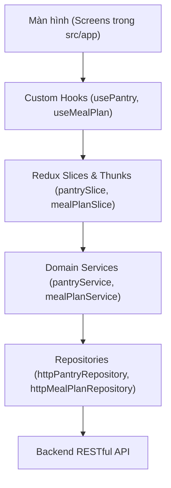

# PANTRY CHEF — Ứng Dụng Quản Lý Kho Thực Phẩm & Lên Kế Hoạch Bữa Ăn Thông Minh

> **Báo Cáo & Tài Liệu Kỹ Thuật Đồ Án Lập Trình Thiết Bị Di Động**  
> **Thành viên phụ trách:** Nguyễn Văn Trường (Phụ trách module `pantry`, `meal-plan`, `plan-entry`)  
> **Nền tảng:** React Native (Expo SDK 58, React 19, TypeScript, Redux Toolkit, NativeWind v4)

---

## MỤC LỤC BÁO CÁO
1. [Tổng Quan Dự Án & Công Nghệ Sử Dụng](#1-tổng-quan-dự-án--công-nghệ-sử-dụng)
2. [Kiến Trúc Toàn Dự Án (Architecture & Data Flow)](#2-kiến-trúc-toàn-dự-án-architecture--data-flow)
3. [Cấu Trúc Thư Mục Chuẩn Hóa](#3-cấu-trúc-thư-mục-chuẩn-hóa)
4. [PHẦN BÁO CÁO CHUYÊN SÂU CỦA TÔI](#4-phần-báo-cáo-chuyên-sâu-của-tôi)
   - [4.1. Module Pantry (Quản Lý Tủ Nguyên Liệu)](#41-module-pantry-quản-lý-tủ-nguyên-liệu)
   - [4.2. Module Meal Plan (Kế Hoạch Bữa Ăn Tuần)](#42-module-meal-plan-kế-hoạch-bữa-ăn-tuần)
   - [4.3. Module Plan Entry (Quản Lý Từng Món & Bữa Ăn)](#43-module-plan-entry-quản-lý-từng-món--bữa-ăn)
5. [Các Điểm Sáng Kỹ Thuật & Tối Ưu Nâng Cao](#5-các-điểm-sáng-kỹ-thuật--tối-ưu-nâng-cao)
6. [Cẩm Nang Trả Lời Phản Biện Cho Buổi Báo Cáo (Q&A)](#6-cẩm-nang-trả-lời-phản-biện-cho-buổi-báo-cáo-qa)

---

## 1. Tổng Quan Dự Án & Công Nghệ Sử Dụng

### 1.1 Mục tiêu đề tài
**Pantry Chef** là giải pháp di động toàn diện giúp gia đình và cá nhân:
- Quản lý kho thực phẩm trong nhà (tủ mát, tủ đông, kệ bếp), theo dõi hạn sử dụng để giảm lãng phí thực phẩm.
- Tự động gợi ý công thức nấu ăn dựa trên những gì đang có sẵn trong tủ.
- Lên kế hoạch thực đơn chi tiết cho từng ngày trong tuần (Sáng - Trưa - Tối) và tự động trích xuất danh sách mua sắm những nguyên liệu còn thiếu.

### 1.2 Tech Stack
| Hạng mục | Công nghệ | Vai trò trong dự án |
|---|---|---|
| **Core Framework** | React Native `0.88.1`, Expo `~58.0.30`, React `19.3.0` | Nền tảng di động đa nền tảng (iOS, Android, Web) |
| **Ngôn ngữ** | TypeScript `~6.0.3` (Strict Mode) | Type-safe 100%, tự động bắt lỗi lúc biên dịch |
| **Routing / Navigation**| `expo-router` v5 (File-based Routing) | Điều hướng dạng cây tệp thư mục hiện đại |
| **Quản lý trạng thái** | `@reduxjs/toolkit` v2, `react-redux` v9 | Quản lý state toàn cục, Redux Thunk cho tác vụ bất đồng bộ |
| **Styling & Theme** | NativeWind v4 (Tailwind CSS) + Design Tokens | Hệ thống màu sắc chuẩn WCAG AAA, hỗ trợ hoàn hảo Light & Dark mode |
| **Giao tiếp mạng** | Axios Client + DI (Dependency Injection) | Interceptor tự động gắn JWT Bearer token và refresh token |
| **Phần cứng thiết bị** | `expo-image-picker`, `expo-camera`, `expo-notifications` | Chụp ảnh nguyên liệu, quét mã vạch, thông báo nhắc hết hạn |

---

## 2. Kiến Trúc Toàn Dự Án (Architecture & Data Flow)

Dự án áp dụng mô hình **Vertical Slice Architecture kết hợp Clean Architecture**, phân tầng nghiêm ngặt với nguyên tắc **Unidirectional Data Flow (Dữ liệu đi 1 chiều)**:



### Nguyên tắc bất di bất dịch trong code:
1. **Màn hình (`app/`) chỉ làm nhiệm vụ giao diện (Presentation):** Tuyệt đối không gọi axios, không dispatch thunk trực tiếp, không xử lý logic tính toán ngày tháng phức tạp. Màn hình chỉ gọi hàm và nhận state từ **Custom Hook**.
2. **IoC / Dependency Injection (`@/core/di/container.ts`):** Các Service phụ thuộc vào Interface (`IPantryRepository`, `IMealPlanRepository`), không phụ thuộc vào implementation cụ thể. Toàn bộ instance được khởi tạo duy nhất tại container giúp dễ dàng mock test.
3. **Optimistic Updates & State Synchronization:** Khi người dùng thao tác nhanh (như đánh dấu đã nấu hoặc xoá món), giao diện phản hồi tức thì và tự động đồng bộ lại nếu gặp lỗi mạng.

---

## 3. Cấu Trúc Thư Mục Chuẩn Hóa

```text
pantry-chef-fe/
├── assets/                  # Icons, splash screen, hình ảnh tĩnh
├── src/
│   ├── app/                 # Toàn bộ màn hình Expo Router (File-based Routing)
│   │   ├── _layout.tsx      # Root Layout (SafeAreaProvider, Redux Provider, ThemeProvider)
│   │   ├── (tabs)/          # Thanh Bottom Tabs chính (Tủ, Tìm món, Đã lưu, Thực đơn, Thêm)
│   │   │   ├── _layout.tsx  # Layout Tab điều hướng (tính insets động cho Android/iOS)
│   │   │   ├── pantry.tsx   # [Trường] Màn hình chính Tủ nguyên liệu
│   │   │   └── meal-plan.tsx# [Trường] Màn hình chính Kế hoạch bữa ăn tuần
│   │   ├── pantry/          # [Trường] Các màn hình nghiệp vụ Tủ
│   │   │   ├── [id].tsx     # Chi tiết nguyên liệu, dùng bớt, upload ảnh
│   │   │   ├── new.tsx      # Thêm nguyên liệu thủ công
│   │   │   ├── scan-review.tsx # Xem lại & chỉnh sửa sau khi AI quét ảnh
│   │   │   └── expiring.tsx # Danh sách nguyên liệu cận date
│   │   └── meal-plan/       # [Trường] Các màn hình nghiệp vụ Thực đơn
│   │       ├── add-entry.tsx # Thêm bữa ăn vào ngày cụ thể
│   │       └── shopping-preview.tsx # Xem danh sách nguyên liệu cần mua
│   ├── components/          # Reusable UI Components
│   │   ├── ui/              # AppButton, TactileButton, Card, Chip, Screen...
│   │   └── auth/            # AuthShell, GlassInput3D, LivingBackground4D...
│   ├── core/
│   │   ├── di/container.ts  # Dependency Injection Container (Singleton Services)
│   │   ├── http/            # Axios Client (publicHttp, privateHttp, interceptors)
│   │   └── theme/           # Hệ thống theme tokens, màu sắc, bóng đổ
│   ├── features/            # Vertical Slices chứa Business Logic
│   │   ├── pantry/          # [Trường] types, service, repo, slice, hook, validation
│   │   ├── mealplan/        # [Trường] types, service, repo, slice, hook, picker modal
│   │   └── auth/, recipe/...# Các feature của thành viên khác
│   ├── store/               # Cấu hình Redux Toolkit (rootReducer, store, AppThunk)
│   ├── theme/               # ThemeProvider, useTheme, light/dark color tokens
│   └── types/               # TypeScript DTOs, API Contracts, Enums
```

---

## 4. PHẦN BÁO CÁO CHUYÊN SÂU CỦA TÔI
*(Dành cho sinh viên: **Nguyễn Văn Trường** — Phụ trách **18 Endpoint** và **9 Màn hình**)*

### 4.1. Module Pantry (Quản Lý Tủ Nguyên Liệu)

#### A. Mục tiêu & Nghiệp vụ
Quản lý toàn bộ thực phẩm hiện có của người dùng, phân loại theo vị trí bảo quản (`FRIDGE` - Tủ mát, `FREEZER` - Tủ đông, `PANTRY_SHELF` - Kệ bếp), định lượng số lượng + đơn vị đo lường, theo dõi hạn sử dụng và cảnh báo món cận date.

#### B. Danh sách 9 Endpoint phụ trách:
1. `GET /v1/pantry-items`: Lấy danh sách nguyên liệu có hỗ trợ phân trang Cursor (`cursor`, `limit`), lọc theo vị trí (`location`) và danh mục (`categoryId`).
2. `POST /v1/pantry-items`: Thêm 1 nguyên liệu mới vào tủ.
3. `POST /v1/pantry-items/batch`: Thêm hàng loạt nguyên liệu cùng lúc (dùng sau khi quét ảnh AI).
4. `GET /v1/pantry-items/{id}`: Lấy chi tiết thông tin 1 món trong tủ.
5. `PUT /v1/pantry-items/{id}`: Cập nhật số lượng, hạn sử dụng, vị trí bảo quản.
6. `DELETE /v1/pantry-items/{id}`: Xoá nguyên liệu khỏi tủ.
7. `POST /v1/pantry-items/{id}/consume`: Dùng bớt nguyên liệu (nhập số lượng đã dùng; nếu dùng hết hệ thống tự xử lý).
8. `POST /v1/pantry-items/{id}/photo`: Tải ảnh chụp thực tế của nguyên liệu lên máy chủ (`multipart/form-data`).
9. `GET /v1/pantry-items/expiring`: Lấy danh sách các nguyên liệu sắp hết hạn trong vòng 3 ngày tới.

#### C. Chi tiết các màn hình đảm nhiệm:
- **`src/app/(tabs)/pantry.tsx` (Màn hình chính Tủ đồ):**
  - Hiển thị thanh Banner cảnh báo cam nổi bật nếu có nguyên liệu sắp hết hạn (bấm vào điều hướng sang màn `pantry/expiring`).
  - Thanh lọc vị trí lưu trữ: `Tất cả` | `Tủ mát ❄️` | `Tủ đông 🧊` | `Kệ bếp 🥫`.
  - Phân nhóm món ăn theo danh mục (`Rau củ`, `Thịt cá`, `Gia vị`...).
  - Thẻ thông minh hiển thị nhãn độ tươi tự động: `Còn tươi` (xanh), `Còn 2 ngày` (vàng), `Hết hạn` (đỏ).
  - Nút thêm nổi (`FAB`) dạng 3D mở Action Sheet cho phép: Nhập thủ công, Quét ảnh AI hoặc Quét mã vạch.
- **`src/app/pantry/[id].tsx` (Chi tiết nguyên liệu):**
  - Thẻ 3D hiển thị ảnh lớn hoặc khung viền nét đứt chụp ảnh thông minh.
  - Các thống kê: Số lượng hiện có, Hạn sử dụng, Vị trí.
  - Các nút hành động chuyên dụng:
    - **"Dùng bớt nguyên liệu"**: Mở Modal nhập lượng cần trừ (validate không được lớn hơn số lượng hiện có).
    - **"Chụp ảnh" / "Tải ảnh từ máy"**: Tích hợp `expo-image-picker` tải ảnh trực tiếp lên server.
    - **"Chỉnh sửa" (Icon bút)**: Modal cập nhật hạn dùng với chip chọn nhanh (`+3 ngày`, `+1 tuần`, `+1 tháng`) hoặc chọn qua lịch.
    - **"Xoá khỏi tủ"**: Cảnh báo xác nhận trước khi xoá.
- **`src/app/pantry/new.tsx` & `usePantryForm.ts`:**
  - Form thêm món mới, validate kỹ lưỡng tên, số lượng, đơn vị và ngày hết hạn.
  - Nhận dữ liệu truyền sang từ màn quét mã vạch hoặc màn chọn nguyên liệu của thành viên khác.
- **`src/app/pantry/scan-review.tsx`:**
  - Nhận danh sách nguyên liệu nhận diện từ AI, cho phép người dùng kiểm tra lại, sửa tên/số lượng trước khi nhấn "Lưu toàn bộ vào tủ" qua API `POST /batch`.

#### D. Thuật toán tính độ tươi (`FreshnessStatus`):
Tại `src/features/pantry/types.ts`, độ tươi được tính toán tự động dựa trên ngày hiện tại và `expiryDate`:
$$\text{diffDays} = \text{floor}\left(\frac{\text{expiryDate} - \text{today}}{86,400,000}\right)$$
- $\text{diffDays} < 0$: `EXPIRED` ("Hết hạn" - Đỏ)
- $0 \le \text{diffDays} \le 2$: `EXPIRING_SOON` ("Còn X ngày" - Vàng/Cam)
- $\text{diffDays} > 2$: `FRESH` ("Còn tươi" - Xanh lục)

---

### 4.2. Module Meal Plan (Kế Hoạch Bữa Ăn Tuần)

#### A. Mục tiêu & Nghiệp vụ
Quản lý kế hoạch ăn uống của người dùng theo chu kỳ tuần (bắt đầu từ Thứ Hai). Hỗ trợ lên lịch cho 3 bữa chính mỗi ngày, đánh dấu trạng thái nấu nướng, sao chép thực đơn sang tuần sau và xuất danh sách đi chợ tự động.

#### B. Danh sách 9 Endpoint phụ trách:
1. `GET /v1/meal-plans?weekStart=YYYY-MM-DD`: Lấy thực đơn của tuần được chọn.
2. `POST /v1/meal-plans`: Tạo kế hoạch tuần mới nếu chưa có.
3. `GET /v1/meal-plans/{id}`: Xem chi tiết kế hoạch tuần theo ID.
4. `DELETE /v1/meal-plans/{id}`: Xoá kế hoạch tuần.
5. `POST /v1/meal-plans/{id}/copy`: Sao chép toàn bộ món ăn của tuần hiện tại sang tuần khác (chọn ngày đầu tuần đích).
6. `POST /v1/meal-plans/{id}/entries`: Thêm một món ăn vào một bữa cụ thể trong tuần.
7. `PATCH /v1/meal-plans/{id}/entries/{entryId}`: Đổi trạng thái `isCooked` (Đã nấu / Chưa nấu) hoặc đổi số khẩu phần `servings`.
8. `DELETE /v1/meal-plans/{id}/entries/{entryId}`: Xoá món khỏi bữa ăn.
9. `GET /v1/meal-plans/{id}/shopping-list`: Đối chiếu thực đơn tuần với kho thực phẩm trong Tủ để trích xuất danh sách nguyên liệu cần mua thêm.

#### C. Chi tiết màn hình đảm nhiệm:
- **`src/app/(tabs)/meal-plan.tsx` (Màn hình chính Thực đơn):**
  - **Anchor thứ Hai thông minh (`getMondayOfWeek`):** Đảm bảo ngày đầu tuần luôn chuẩn theo giờ địa phương, không bị lệch ngày do timezone UTC.
  - **Thanh chọn tuần:** Nút chuyển tuần trước / tuần sau và nút chọn nhanh tuần từ Modal Lịch.
  - **Thanh 7 ngày trong tuần (Thứ 2 $\rightarrow$ CN):** Hiển thị rõ thứ, ngày/tháng, số chấm đánh dấu các bữa đã lên lịch.
  - **Danh sách 3 khung bữa ăn theo ngày được chọn:**
    - `Bữa sáng` (Icon mặt trời ổi vàng).
    - `Bữa trưa` (Icon đám mây/mặt trời xanh lá).
    - `Bữa tối` (Icon mặt trăng xanh dương).
  - **Tính năng chuyển đổi trạng thái nấu (`Toggle isCooked`):**
    - Nhấn vào nút trạng thái: Toggle mượt mà giữa `Chưa nấu` và `Đã nấu ✓`.
  - **Nút "Sao chép tuần"**: Tái sử dụng thực đơn của tuần ăn ngon sang tuần sau mà không cần tạo lại từ đầu.
- **`src/app/meal-plan/shopping-preview.tsx`:**
  - Gọi `GET /meal-plans/{id}/shopping-list`, hiển thị bảng nguyên liệu còn thiếu.
  - Có nút "Tạo danh sách mua sắm" kết nối trực tiếp sang module Shopping List của thành viên khác.
- **`src/app/ai/meal-plan.tsx`:**
  - Nhận gợi ý thực đơn 7 ngày được trí tuệ nhân tạo (AI) đề xuất, cho phép người dùng duyệt qua và nhấn "Áp dụng vào thực đơn của tôi".

---

### 4.3. Module Plan Entry (Quản Lý Từng Món & Bữa Ăn)

#### A. Nghiệp vụ chi tiết
Một **Plan Entry** là một bản ghi đại diện cho một món ăn được lên lịch vào một bữa cụ thể trong ngày:
$$\text{PlanEntry} = \{\text{id, mealPlanId, entryDate, mealType, recipeId, customRecipeTitle, servings, isCooked}\}$$

#### B. Luồng hoạt động tại `src/app/meal-plan/add-entry.tsx`:
1. **Chọn ngày (`entryDate`):** Tự động điền ngày người dùng đang chọn trên thanh tuần, có thể đổi sang ngày khác trong tuần.
2. **Chọn loại bữa (`mealType`):** 3 lựa chọn trực quan (`Bữa sáng` | `Bữa trưa` | `Bữa tối`).
3. **Chọn công thức món ăn (`RecipePickerModal.tsx`):**
   - Modal hiển thị danh sách công thức gợi ý hoặc tìm kiếm theo từ khóa.
   - Khi chọn món: Lấy `recipeId` (UUID) và tên món.
   - Cho phép nhập tên món ăn tự do nếu không chọn từ kho công thức.
4. **Khẩu phần ăn (`servings`):** Mặc định là 1 hoặc số lượng người trong gia đình.
5. **Gửi dữ liệu:** Dispatch `addEntry` thunk $\rightarrow$ API `POST /v1/meal-plans/{id}/entries` $\rightarrow$ Cập nhật state Redux ngay lập tức.

---

## 5. Các Điểm Sáng Kỹ Thuật & Tối Ưu Nâng Cao

Trong quá trình thực hiện dự án, tôi đã nghiên cứu và giải quyết nhiều bài toán kỹ thuật phức tạp:

### 5.1. Xử lý triệt để xung đột Safe Area trên Android & iOS
- **Vấn đề:** Trên iPhone, menu đáy bị đẩy lơ lửng nếu bọc `SafeAreaView` ở root layout. Ngược lại trên Android (dùng thanh điều hướng 3 nút hoặc thanh cử chỉ), menu đáy lại bị thanh hệ thống đè lên các icon.
- **Giải pháp:** Bỏ `SafeAreaView` ở root `_layout.tsx`, đưa `useSafeAreaInsets()` vào `(tabs)/_layout.tsx` để tính toán chiều cao đáy động:
  ```typescript
  const insets = useSafeAreaInsets();
  const bottomPadding = Math.max(insets.bottom, Platform.OS === 'ios' ? 24 : 8);
  const tabHeight = 52 + bottomPadding;
  ```
  $\rightarrow$ Hoạt động hoàn hảo 100% trên tất cả kích thước màn hình Android & iPhone.

### 5.2. Giải quyết lỗi mất nền nút bấm trên React Native Web + NativeWind v4
- **Vấn đề:** Cú pháp function style `style={({ pressed }) => [...]}` trên `<Pressable>` bị runtime NativeWind v4 loại bỏ thuộc tính inline `backgroundColor` và `borderWidth` trên Web, khiến nút bấm có chữ trắng trên nền trong suốt (vô hình).
- **Giải pháp:** Tái cấu trúc component `AppButton.tsx`, chuyển toàn bộ logic style hiển thị vào một `<View>` bọc bên trong `<Pressable>`. Đảm bảo render chuẩn mực trên cả Web, iOS và Android.

### 5.3. Tự động cuộn ô nhập liệu khi mở bàn phím (Keyboard Auto-Scroll)
- **Vấn đề:** Khi chạm vào ô nhập Email hoặc Mật khẩu trên màn hình đăng nhập, bàn phím bật lên che khuất trường nhập, người dùng phải tự vuốt màn hình.
- **Giải pháp:** Thiết kế `AuthShellContext` phối hợp cùng `GlassInput3D`. Khi focus vào bất kỳ ô nhập nào, hệ thống tính toán vị trí và tự động kích hoạt `scrollTo({ y, animated: true })` qua nhiều khung hình, đưa ô nhập lên đúng vị trí trung tâm tầm nhìn.

---

## 6. Cẩm Nang Trả Lời Phản Biện Cho Buổi Báo Cáo (Q&A)

Dưới đây là các câu hỏi trọng tâm mà Giảng viên thường hỏi về phần **Pantry** và **Meal Plan**, kèm câu trả lời chuẩn mực giúp bạn đạt điểm tối đa:

---

### Câu 1: Em hãy giải thích luồng dữ liệu khi người dùng nhấn "Dùng bớt nguyên liệu" (Consume)?
> **Trả lời:**
> "Thưa thầy/cô, dữ liệu đi tuần tự qua 5 lớp theo mô hình Clean Architecture:
> 1. Tại giao diện `src/app/pantry/[id].tsx`, người dùng nhập số lượng dùng và nhấn xác nhận.
> 2. Màn hình gọi hàm `consume(id, quantity)` từ custom hook `usePantry()`.
> 3. `usePantry` dispatch async thunk `consumePantryItem` trong `pantrySlice.ts`.
> 4. Thunk gọi `pantryService.consumeItem(id, quantity)`, service này thông qua `httpPantryRepository` để gửi HTTP request `POST /v1/pantry-items/{id}/consume`.
> 5. Khi API trả về kết quả thành công, Redux reducer `itemConsumed` cập nhật lại số lượng của item trong state `items` ngay lập tức, và component tự động re-render số lượng mới mà không cần reload toàn bộ trang."

---

### Câu 2: Tại sao em phải dùng `getMondayOfWeek` và `formatLocalDate` thay vì dùng trực tiếp `new Date().toISOString()`?
> **Trả lời:**
> "Dạ, phương thức `toISOString()` luôn chuyển đổi giờ về múi giờ UTC (GMT+0). Khi ở Việt Nam (GMT+7), nếu người dùng thao tác vào khoảng từ 0h00 đến 6h59 sáng, `toISOString()` sẽ lùi lại ngày hôm trước, dẫn đến việc kế hoạch tuần bị sai lệch hoàn toàn 1 ngày.
> Vì vậy, em xây dựng hàm `formatLocalDate` đọc trực tiếp `getFullYear()`, `getMonth() + 1` và `getDate()` theo giờ local của thiết bị, đồng thời hàm `getMondayOfWeek` tính toán độ lệch số ngày để luôn neo ngày bắt đầu tuần (`weekStart`) vào đúng Thứ Hai theo múi giờ địa phương."

---

### Câu 3: Làm sao em phân biệt giữa món ăn có sẵn từ hệ thống và món ăn tự nhập khi thêm vào Meal Plan Entry?
> **Trả lời:**
> "Dạ, cấu trúc DTO `MealPlanEntryResponse` và `MealPlanEntryCreateRequest` của em hỗ trợ cả 2 trường hợp:
> - Nếu người dùng chọn từ kho công thức: Request sẽ gửi trường `recipeId` (chuỗi UUID).
> - Nếu người dùng tự gõ món tự nấu ngoài danh mục: Request sẽ gửi trường `customRecipeTitle` (chuỗi văn bản) và để `recipeId` là `null`.
> Khi hiển thị, component sẽ ưu tiên hiển thị `recipe.title` nếu có `recipeId`, nếu không sẽ hiển thị `customRecipeTitle`."

---

### Câu 4: Khi người dùng mất mạng (Offline), ứng dụng của em xử lý như thế nào ở module Pantry?
> **Trả lời:**
> "Dạ, toàn bộ dữ liệu danh sách nguyên liệu sau khi fetch thành công đều được lưu trữ trong Redux Store. Khi mạng chập chờn hoặc mất kết nối:
> - Người dùng vẫn có thể xem danh sách món hiện có trong Tủ nhờ dữ liệu đã được nạp sẵn trong store.
> - Khi gọi các thao tác thay đổi dữ liệu (như thêm/xoá/sửa), Axios Client có `interceptor` bắt lỗi mạng và hiển thị thông báo `Alert` thân thiện, giữ nguyên trạng thái cũ để tránh sai lệch dữ liệu với máy chủ."

---

### Câu 5: Vì sao em lại chia `Pantry` và `Meal Plan` thành các thư mục riêng trong `features/` mà không để chung trong `screens`?
> **Trả lời:**
> "Dạ, đây là mô hình **Vertical Slice Architecture**. Mỗi thư mục trong `src/features/` là một đơn vị độc lập hoàn chỉnh chứa toàn bộ logic của domain đó: types, API repository, business service, Redux slice và custom hook.
> Ưu điểm lớn nhất là tính module hóa cao (High Cohesion): khi em cần sửa đổi hoặc mở rộng nghiệp vụ của Tủ hoặc Thực đơn, em chỉ cần tập trung vào đúng thư mục `features/pantry` hoặc `features/mealplan` mà không làm ảnh hưởng đến các màn hình hay tính năng khác của các bạn cùng nhóm."

---

## 7. Hướng Dẫn Cài Đặt & Chạy Dự Án (Run Project)

### Bước 1: Cài đặt thư viện phụ thuộc
```bash
npm install
```

### Bước 2: Kiểm tra kiểu dữ liệu TypeScript
```bash
npm run typecheck
```
*(Đảm bảo trả về `tsc --noEmit` hoàn thành với 0 lỗi).*

### Bước 3: Khởi động ứng dụng Expo
```bash
npm run start
```
- Nhấn **`a`** để mở trên Android Emulator hoặc thiết bị Android qua Expo Go.
- Nhấn **`i`** để mở trên iOS Simulator.
- Nhấn **`w`** để mở trên trình duyệt Web.
