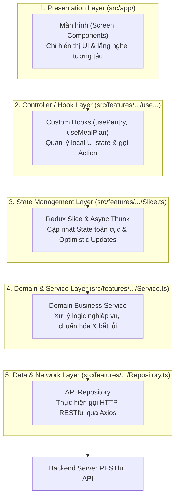

# PANTRY CHEF — TỔNG THỂ CẤU TRÚC VÀ CHỨC NĂNG DỰ ÁN
> **Tài Liệu Kỹ Thuật & Cẩm Nang Báo Cáo Chuyên Sâu Đồ Án Lập Trình Thiết Bị Di Động**  
> **Sinh viên phụ trách:** Nguyễn Văn Trường (MSSV: 23653651)  
> **Phân hệ đảm nhiệm:** `Pantry` (Kho thực phẩm), `Meal Plan` (Kế hoạch bữa ăn), `Plan Entry` (Chi tiết bữa ăn) — **18 Endpoints & 9 Màn hình**  
> **Nền tảng phát triển:** React Native (Expo SDK 58, React 19, TypeScript Strict Mode, Redux Toolkit, NativeWind v4)

---

## MỤC LỤC TÀI LIỆU
1. [Tổng Quan Đề Tài & Mục Tiêu Dự Án](#1-tổng-quan-đề-tài--mục-tiêu-dự-án)
2. [Ngăn Xếp Công Nghệ (Tech Stack)](#2-ngăn-xếp-công-nghệ-tech-stack)
3. [Kiến Trúc Hệ Thống & Luồng Dữ Liệu Toàn Cục](#3-kiến-trúc-hệ-thống--luồng-dữ-liệu-toàn-cục)
4. [Cấu Trúc Thư Mục Dự Án (File & Folder Structure)](#4-cấu-trúc-thư-mục-dự-án-file--folder-structure)
5. [Bức Tranh Tổng Thể 6 Phân Hệ Của Nhóm](#5-bức-tranh-tổng-thể-6-phân-hệ-của-nhóm)
6. [Báo Cáo Chi Tiết Phân Hệ Của Nguyễn Trường](#6-báo-cáo-chi-tiết-phân-hệ-của-nguyễn-trường)
   - [6.1. Module Pantry (Quản Lý Tủ Nguyên Liệu)](#61-module-pantry-quản-lý-tủ-nguyên-liệu)
   - [6.2. Module Meal Plan (Kế Hoạch Thực Đơn Tuần)](#62-module-meal-plan-kế-hoạch-thực-đơn-tuần)
   - [6.3. Module Plan Entry (Chi Tiết Bữa Ăn & Khẩu Phần)](#63-module-plan-entry-chi-tiết-bữa-ăn--khẩu-phần)
7. [Các Điểm Sáng Kỹ Thuật & Tối Ưu Nâng Cao](#7-các-điểm-sáng-kỹ-thuật--tối-ưu-nâng-cao)
8. [Kịch Bản Thuyết Trình Demo Mẫu (5 - 7 Phút)](#8-kịch-bản-thuyết-trình-demo-mẫu-5---7-phút)
9. [Cẩm Nang Trả Lời Câu Hỏi Phản Biện Của Giảng Viên (Q&A)](#9-cẩm-nang-trả-lời-câu-hỏi-phản-biện-của-giảng-viên-qa)

---

## 1. Tổng Quan Đề Tài & Mục Tiêu Dự Án

### 1.1 Vấn đề thực tế
Trong cuộc sống hiện đại, các gia đình và bạn trẻ thường gặp các vấn đề:
- Mua nhiều thực phẩm nhưng quên dùng dẫn đến hết hạn, ôi thiu và lãng phí tiền bạc.
- Hàng ngày đau đầu với câu hỏi *"Hôm nay ăn gì?"* dù trong tủ lạnh vẫn còn rất nhiều nguyên liệu.
- Đi chợ không có kế hoạch, mua thừa những thứ đã có sẵn và thiếu những gia vị quan trọng.

### 1.2 Giải pháp của Pantry Chef
**Pantry Chef** là giải pháp số hóa toàn diện việc quản lý thực phẩm và dinh dưỡng gia đình:
1. **Quản lý kho thực phẩm (Pantry):** Phân loại theo ngăn lưu trữ (*Tủ mát, Tủ đông, Kệ bếp*), cảnh báo trực quan các món cận date bằng hệ thống màu sắc nhận diện độ tươi.
2. **Gợi ý món ăn thông minh (Smart Recipe Matching):** Tự động đối chiếu những gì đang có sẵn trong tủ để đề xuất các công thức nấu ăn thích hợp nhất, xếp hạng theo độ khớp nguyên liệu.
3. **Lên kế hoạch bữa ăn tuần (Meal Planning):** Xếp lịch cho 3 bữa ăn mỗi ngày (Sáng, Trưa, Tối), theo dõi trạng thái *"Đã nấu" / "Chưa nấu"*, và hỗ trợ nhân bản thực đơn tuần chỉ với 1 chạm.
4. **Tự động hóa mua sắm (Auto Shopping List):** Hệ thống quét thực đơn tuần, đối chiếu với tủ thực phẩm và tự động trích xuất danh sách những món còn thiếu cần mua.
5. **Ứng dụng AI & Thị giác máy tính (Computer Vision):** Quét bao bì sản phẩm bằng camera để nhận diện mã vạch EAN-13, quét ảnh chụp tủ lạnh bằng AI để nhận diện hàng loạt nguyên liệu.

---

## 2. Ngăn Xếp Công Nghệ (Tech Stack)

| Hạng mục | Công nghệ | Phiên bản | Vai trò kỹ thuật trong dự án |
|---|---|---|---|
| **Core Framework** | React Native | `0.88.1` | Khung phát triển ứng dụng di động đa nền tảng |
| **Tooling & Runtime**| Expo SDK | `~58.0.30` | Hệ sinh thái build, test và truy cập API phần cứng |
| **Giao diện cốt lõi** | React | `19.3.0` | Thư viện xây dựng UI với Virtual DOM tối ưu |
| **Ngôn ngữ** | TypeScript | `~6.0.3` | Kiểu dữ liệu chặt chẽ (Strict Mode), tránh lỗi runtime |
| **Điều hướng** | `expo-router` | `v5` | Routing dạng cây thư mục (File-based Routing) hiện đại |
| **Quản lý trạng thái** | `@reduxjs/toolkit` | `v2` | Quản lý state toàn cục dự đoán được, Redux Thunk bất đồng bộ |
| **Giao diện & Styling**| NativeWind | `v4` | Hệ thống Tailwind CSS trên React Native, hỗ trợ Light & Dark theme |
| **Giao tiếp mạng** | Axios Client | `v1.7` | HTTP Client bọc Interceptor, tự động tiêm JWT và refresh token |
| **Truy cập phần cứng** | Expo Hardware APIs| Mới nhất | `expo-camera`, `expo-image-picker`, `expo-notifications` |

---

## 3. Kiến Trúc Hệ Thống & Luồng Dữ Liệu Toàn Cục

Dự án áp dụng mô hình **Vertical Slice Architecture kết hợp Clean Architecture**, tuân thủ nghiêm ngặt nguyên tắc **Unidirectional Data Flow (Dữ liệu đi 1 chiều)**:



### Các nguyên tắc vàng trong kiến trúc:
1. **Phân tách trách nhiệm triệt để (Separation of Concerns):** Màn hình tuyệt đối không gọi trực tiếp API `axios`, không xử lý tính toán ngày giờ phức tạp; toàn bộ logic được đóng gói trong **Custom Hook**.
2. **Đảo ngược phụ thuộc (Dependency Injection - DI Container):** Toàn bộ service và repository được đăng ký và khởi tạo tập trung tại `@/core/di/container.ts`. Các service phụ thuộc vào Interface (`IPantryRepository`, `IMealPlanRepository`), giúp code không bị phụ thuộc chặt chẽ và dễ dàng viết Unit Test / Mocking.
3. **Optimistic Updates & Đồng bộ:** Khi người dùng đánh dấu đã nấu hoặc xoá món, giao diện cập nhật phản hồi tức thì và tự động khôi phục nếu có lỗi mạng.

---

## 4. Cấu Trúc Thư Mục Dự Án (File & Folder Structure)

```text
pantry-chef-fe/
├── assets/                     # Icons, splash screen, hình ảnh tĩnh của ứng dụng
├── src/
│   ├── app/                    # [Presentation Layer] Màn hình Expo Router (File-based Routing)
│   │   ├── _layout.tsx         # Root Layout: SafeAreaProvider, Redux Provider, ThemeProvider
│   │   ├── (tabs)/             # 5 Màn hình chính nằm trên thanh menu đáy (Bottom Tabs)
│   │   │   ├── _layout.tsx     # Cấu hình Tab Bar, tính toán chiều cao và đệm an toàn động
│   │   │   ├── pantry.tsx      # [Trường] Màn hình chính Quản lý Tủ nguyên liệu
│   │   │   ├── search.tsx      # [Tùng] Màn hình Tìm kiếm công thức nấu ăn
│   │   │   ├── saved.tsx       # [Thuận] Màn hình Công thức đã lưu & Bộ sưu tập
│   │   │   ├── meal-plan.tsx   # [Trường] Màn hình Kế hoạch thực đơn tuần 7 ngày
│   │   │   └── more.tsx        # Màn hình cài đặt, thông tin tài khoản & tiện ích
│   │   ├── pantry/             # [Trường] Màn hình nghiệp vụ Tủ nguyên liệu
│   │   │   ├── [id].tsx        # Xem chi tiết món, dùng bớt (consume), đổi hạn dùng, chụp ảnh
│   │   │   ├── new.tsx         # Form nhập thêm nguyên liệu thủ công vào tủ
│   │   │   ├── barcode.tsx     # Quét mã vạch bao bì bằng camera
│   │   │   ├── scan-review.tsx # Xem lại và chỉnh sửa sau khi AI quét ảnh tủ lạnh
│   │   │   └── expiring.tsx    # Danh sách nguyên liệu cận date cần dùng gấp
│   │   └── meal-plan/          # [Trường] Màn hình nghiệp vụ Thực đơn
│   │       ├── [id].tsx        # Chi tiết thực đơn tuần theo ID
│   │       ├── add-entry.tsx   # Form thêm món ăn vào bữa (Sáng / Trưa / Tối)
│   │       └── shopping-preview.tsx # Danh sách đối chiếu nguyên liệu cần mua sắm
│   ├── components/             # Các UI Components tái sử dụng toàn dự án
│   │   ├── ui/                 # AppButton, TactileButton, Card, Badge, Screen, DatePicker...
│   │   ├── auth/               # LivingBackground4D, GlassInput3D, AuthShell...
│   │   └── recipe/             # RecipePickerModal, RecipeCard...
│   ├── core/                   # Cấu hình hạt nhân dùng chung
│   │   ├── di/container.ts     # Dependency Injection Container (Singleton Services)
│   │   ├── http/               # Axios Client cấu hình publicHttp, privateHttp, interceptors
│   │   └── format/             # Hàm format ngày giờ, tiền tệ, khối lượng chuẩn địa phương
│   ├── features/               # Các lát cắt dọc chức năng (Vertical Slices)
│   │   ├── pantry/             # [Trường] types, service, repo, slice, hook, validation
│   │   ├── mealplan/           # [Trường] types, service, repo, slice, hook, picker modal
│   │   ├── auth/               # Xác thực người dùng, JWT, refresh token
│   │   ├── recipe/             # Quản lý công thức, tính toán khẩu phần, bước nấu
│   │   ├── shopping/           # Quản lý danh sách mua sắm
│   │   └── ingredient/         # Danh mục nguyên liệu dùng chung
│   ├── store/                  # Cấu hình Redux Toolkit (rootReducer, store, AppThunk)
│   ├── theme/                  # Hệ thống màu sắc Design Tokens, ThemeProvider
│   └── types/                  # Định nghĩa TypeScript DTOs, API Requests & Responses
```

---

## 5. Bức Tranh Tổng Thể 6 Phân Hệ Của Nhóm

Dự án có tổng cộng **93 API Endpoints** và **50 Màn hình**, phân chia dọc theo 6 thành viên:

| STT | Thành viên | Phân hệ phụ trách | Số Endpoint | Số Màn hình | Nhiệm vụ chính |
|:---:|---|---|:---:|:---:|---|
| 1 | **Thịnh (Lead)** | `auth`, `user`, `ai` | 18 | 15 | Khung dự án, xác thực JWT, hồ sơ cá nhân, các API AI nhận diện ảnh |
| 2 | **Việt** | `ingredient`, `excluded`, `sync` | 16 | 5 | Danh mục nguyên liệu chuẩn, nguyên liệu dị ứng/loại trừ, đồng bộ dữ liệu |
| 3 | **Trường** | `pantry`, `meal-plan` | **18** | **9** | **Kho thực phẩm gia đình, cảnh báo hết hạn, thực đơn tuần, đối chiếu mua sắm** |
| 4 | **Tùng** | `recipe`, `customRecipe` | 14 | 7 | Tích hợp công thức ngoài, tìm kiếm theo nguyên liệu có sẵn, chế độ nấu từng bước |
| 5 | **Thuận** | `savedRecipe`, `collection`, `stats`| 12 | 6 | Lưu món yêu thích, quản lý bộ sưu tập nấu ăn, thống kê dinh dưỡng |
| 6 | **Thiệu** | `shopping`, `cuisine`, `unit` | 15 | 8 | Danh sách đi chợ, quản lý danh mục ẩm thực, đổi đơn vị đo lường |

---

## 6. Báo Cáo Chi Tiết Phân Hệ Của Nguyễn Trường
*(Phụ trách **18 Endpoint** và **9 Màn hình**, chia làm 3 cụm nghiệp vụ trọng điểm)*

---

### 6.1. Module Pantry (Quản Lý Tủ Nguyên Liệu)

#### A. Nghiệp vụ cốt lõi
- **3 vị trí bảo quản thực phẩm:**
  - `FRIDGE`: Tủ mát ❄️ (Nhiệt độ 1°C - 4°C, bảo quản rau củ, trứng sữa, thức ăn thừa).
  - `FREEZER`: Tủ đông 🧊 (Nhiệt độ $\le$ -18°C, bảo quản thịt cá, hải sản lâu dài).
  - `PANTRY_SHELF`: Kệ bếp / Nhiệt độ phòng 🥫 (Bảo quản gia vị, đồ khô, đồ hộp).
- **Thuật toán tính độ tươi thông minh (`FreshnessStatus`):**
  $$\text{diffDays} = \text{floor}\left(\frac{\text{expiryDate} - \text{today}}{86,400,000}\right)$$
  - $\text{diffDays} < 0$: `EXPIRED` — **Hết hạn** (Huy hiệu Đỏ, khuyến cáo không nên dùng).
  - $0 \le \text{diffDays} \le 2$: `EXPIRING_SOON` — **Còn 1-2 ngày** (Huy hiệu Vàng/Cam, đẩy lên Banner cảnh báo đầu trang).
  - $\text{diffDays} > 2$: `FRESH` — **Còn tươi** (Huy hiệu Xanh lục).

#### B. 9 API Endpoints phụ trách
1. `GET /v1/pantry-items`: Lấy danh sách nguyên liệu (phân trang Cursor, lọc theo vị trí và danh mục).
2. `POST /v1/pantry-items`: Thêm thủ công 1 nguyên liệu vào tủ.
3. `POST /v1/pantry-items/batch`: Thêm hàng loạt món cùng lúc (dùng sau khi quét ảnh AI).
4. `GET /v1/pantry-items/{id}`: Xem chi tiết 1 nguyên liệu trong tủ.
5. `PUT /v1/pantry-items/{id}`: Cập nhật hạn sử dụng, số lượng, vị trí bảo quản.
6. `DELETE /v1/pantry-items/{id}`: Xoá nguyên liệu khỏi tủ.
7. `POST /v1/pantry-items/{id}/consume`: **Dùng bớt nguyên liệu** (nhập lượng đã nấu; nếu dùng hết hệ thống tự động dọn khỏi tủ).
8. `POST /v1/pantry-items/{id}/photo`: Tải ảnh chụp thực tế của nguyên liệu lên máy chủ (`multipart/form-data`).
9. `GET /v1/pantry-items/expiring`: Lấy danh sách các món sắp hết hạn trong 3 ngày tới.

#### C. Chi tiết các màn hình
- **`src/app/(tabs)/pantry.tsx` (Màn hình chính Tủ đồ):**
  - Banner cảnh báo tinh gọn màu vàng hổ phách trên đầu trang khi có thực phẩm cận date (chạm vào để mở trang chi tiết).
  - Thanh chọn vị trí nhanh: `Tất cả` | `Tủ mát ❄️` | `Tủ đông 🧊` | `Kệ bếp 🥫`.
  - Bộ lọc chip theo danh mục thực phẩm đang có trong tủ.
  - Nút thêm nổi (`FAB`) dạng 3D mở Action Sheet: Quét mã vạch, Quét ảnh AI hoặc Thêm thủ công.
- **`src/app/pantry/expiring.tsx` (Màn hình Sắp hết hạn & Đã hết hạn):**
  - **Tab 1: Sắp hết hạn (⏳)**: Chỉ hiển thị các nguyên liệu còn hạn 0-7 ngày tới (`soon`), hỗ trợ chip chọn ngày (`1 ngày`, `3 ngày`, `7 ngày` hoặc nhập số ngày), nút "Dùng bớt" để trừ số lượng đã nấu.
  - **Tab 2: Đã hết hạn (🗑️)**: Mục riêng biệt chỉ hiển thị các món đã quá hạn (`expired`), có cảnh báo vệ sinh an toàn thực phẩm, nút "Bỏ đi" cho từng món và nút "Bỏ tất cả món hết hạn" để dọn sạch tủ lạnh chỉ với 1 chạm.
- **`src/app/pantry/[id].tsx` (Chi tiết nguyên liệu):**
  - Chức năng **"Dùng bớt nguyên liệu"**: Nhập lượng cần trừ (validate không vượt quá số lượng hiện có, tích hợp `KeyboardAvoidingView` tránh che khuất bàn phím).
  - Chức năng **"Chụp ảnh / Tải ảnh"**: Tích hợp `expo-image-picker` tải ảnh lên máy chủ.
  - Chức năng **"Chỉnh sửa nguyên liệu"**: Modal chỉnh sửa số lượng, vị trí bảo quản và hạn sử dụng; bọc `KeyboardAvoidingView` chống che bàn phím; tích hợp `InlineCalendar` chọn ngày trực quan với ràng buộc cứng không cho chọn ngày quá khứ (`minDate={new Date()}`), cùng các chip chọn nhanh (`+3 ngày`, `+1 tuần`, `+2 tuần`, `+1 tháng`).
- **`src/app/pantry/barcode.tsx` (Quét mã vạch):**
  - Tích hợp `CameraView` nhận diện mã vạch EAN-13, tra cứu thông tin qua API và điền sẵn vào form thêm mới.

---

### 6.2. Module Meal Plan (Kế Hoạch Thực Đơn Tuần)

#### A. Nghiệp vụ cốt lõi
- Quản lý kế hoạch ăn uống 7 ngày trong tuần, bắt đầu từ **Thứ Hai đến Chủ Nhật**.
- Mỗi ngày phân chia làm 3 bữa: **Bữa Sáng (`BREAKFAST`)**, **Bữa Trưa (`LUNCH`)**, **Bữa Tối (`DINNER`)**.
- **Hiển thị số món từng bữa:** Mỗi bữa hiển thị badge đếm số lượng món (`0 món`, `1 món`, `2 món`...) và hỗ trợ xem danh sách nhiều món trong cùng một bữa.
- **Ràng buộc ngày quá khứ (Past Date Protection):** Chặn hoàn toàn việc thêm món ăn vào các ngày đã qua.
- **Đánh dấu đã nấu (`Toggle isCooked`):** Chuyển đổi trực tiếp giữa `Chưa nấu` và `Đã nấu ✓`.
- **Sao chép thực đơn (`Copy Week`):** Sao chép toàn bộ món ăn của tuần hiện tại sang một tuần trong tương lai.
- **Đối chiếu đi chợ (`Shopping Preview`):** Quét thực đơn tuần, so khớp với kho nguyên liệu trong Tủ để trích xuất danh sách nguyên liệu cần mua.

#### B. 9 API Endpoints phụ trách
1. `GET /v1/meal-plans?weekStart=YYYY-MM-DD`: Lấy thực đơn của tuần được chọn.
2. `POST /v1/meal-plans`: Tạo thực đơn tuần mới nếu chưa có.
3. `GET /v1/meal-plans/{id}`: Xem chi tiết thực đơn tuần theo ID.
4. `DELETE /v1/meal-plans/{id}`: Xoá thực đơn tuần.
5. `POST /v1/meal-plans/{id}/copy`: Sao chép thực đơn sang tuần khác.
6. `POST /v1/meal-plans/{id}/entries`: Thêm 1 món vào một bữa trong ngày.
7. `PATCH /v1/meal-plans/{id}/entries/{entryId}`: Đổi trạng thái `isCooked` hoặc đổi số khẩu phần `servings`.
8. `DELETE /v1/meal-plans/{id}/entries/{entryId}`: Xoá món ăn khỏi bữa.
9. `GET /v1/meal-plans/{id}/shopping-list`: Đối chiếu thực đơn với Tủ để tạo danh sách cần mua sắm.

---

### 6.3. Module Plan Entry (Chi Tiết Bữa Ăn & Khẩu Phần)

Một bản ghi món ăn trong thực đơn gồm:
$$\text{PlanEntry} = \{\text{id, mealPlanId, date, mealType, recipeId, recipeTitle, servings, cooked}\}$$

- Màn hình `src/app/meal-plan/add-entry.tsx`:
  - Chọn ngày dùng bữa với lịch khóa cứng ngày quá khứ (`minDate={todayStr}`).
  - Chọn bữa ăn (Sáng / Trưa / Tối).
  - Chọn công thức món ăn thông qua `RecipePickerModal.tsx`.
  - Chọn số lượng khẩu phần ăn (mặc định 1 - 4 người).

---

## 7. Các Điểm Sáng Kỹ Thuật & Tối Ưu Nâng Cao

### 7.1. Xử lý triệt để lệch múi giờ UTC (Timezone Skew Prevention)
- **Vấn đề:** Khi dùng `toISOString().split('T')[0]`, hệ thống luôn đưa về giờ UTC (GMT+0). Tại Việt Nam (GMT+7), nếu người dùng mở ứng dụng từ 0h00 đến 6h59 sáng, ngày sẽ bị lùi về ngày hôm trước, khiến thực đơn tuần bị lệch 1 ngày.
- **Giải pháp:** Tự xây dựng hàm `formatLocalDate` đọc trực tiếp ngày tháng năm theo giờ địa phương của thiết bị và hàm `getMondayOfWeek` luôn neo tuần vào đúng Thứ Hai địa phương:
  ```typescript
  export function formatLocalDate(date: Date): string {
    const y = date.getFullYear();
    const m = String(date.getMonth() + 1).padStart(2, '0');
    const d = String(date.getDate()).padStart(2, '0');
    return `${y}-${m}-${d}`;
  }
  ```

### 7.2. Cơ chế bảo vệ ngày quá khứ 3 lớp (3-Layer Defense-in-Depth)
1. **Lớp giao diện (`meal-plan.tsx`):** Tính toán `isPastDay = activeDay.date < todayStr`. Nếu là ngày quá khứ, ẩn hoàn toàn nút `+ Thêm món` và hiển thị nhãn `"Đã qua"`.
2. **Lớp thành phần (`DatePickerField.tsx`):** Đặt `disableAllTouchEventsForDisabledDays={true}` và chặn sự kiện `onDayPress` nếu `day.dateString < minDate`.
3. **Lớp dữ liệu (`useMealPlan.ts`):** Tại hàm `addEntry`, kiểm tra trực tiếp:
   ```typescript
   if (body.date < todayStr) {
     throw new Error("Không thể thêm bữa ăn cho ngày trong quá khứ");
   }
   ```

### 7.3. Tối ưu Safe Area Insets cho cả iPhone & Android
- **Vấn đề:** Trên iPhone tai thỏ, menu đáy bị lơ lửng nếu bọc `SafeAreaView` ở root layout; còn trên Android có thanh điều hướng 3 nút thì menu đáy bị đè lên icon.
- **Giải pháp:** Bỏ `SafeAreaView` ở root layout, tính toán đệm đáy động trong `(tabs)/_layout.tsx`:
  ```typescript
  const insets = useSafeAreaInsets();
  const bottomPadding = Math.max(insets.bottom, Platform.OS === 'ios' ? 24 : 8);
  const tabHeight = 52 + bottomPadding;
  ```

---

## 8. Kịch Bản Thuyết Trình Demo Mẫu (5 - 7 Phút)

* **Bước 1: Giới thiệu bản thân & vai trò (30 giây):**
  > *"Kính thưa Thầy/Cô và các bạn, em là Nguyễn Văn Trường. Trong đề tài Pantry Chef, em phụ trách 2 phân hệ trung tâm của ứng dụng: Quản lý kho thực phẩm gia đình (Pantry) và Lên kế hoạch bữa ăn tuần (Meal Plan), gồm 18 API Endpoints và 9 màn hình chức năng."*
* **Bước 2: Trình diễn module Pantry (2 phút):**
  1. Mở tab **Tủ**: Giới thiệu Banner cảnh báo thực phẩm cận date, chuyển qua lại các bộ lọc vị trí *Tủ mát, Tủ đông, Kệ bếp*.
  2. Bấm vào 1 món (ví dụ: *Thịt bò*): Bấm nút **"Dùng bớt nguyên liệu"** $\rightarrow$ Nhập lượng đã nấu $\rightarrow$ Số lượng cập nhật ngay lập tức mà không cần reload trang.
  3. Bấm nút nổi **FAB** $\rightarrow$ Demo mở camera quét mã vạch bao bì tự động điền form.
* **Bước 3: Trình diễn module Meal Plan (2.5 phút):**
  1. Mở tab **Thực đơn**: Giới thiệu thanh 7 ngày trong tuần được neo chuẩn xác vào Thứ Hai (`getMondayOfWeek`).
  2. Chỉ vào các bữa ăn: Cho thấy huy hiệu số món (`1 món`, `0 món`). Bấm nút chuyển đổi **"Chưa nấu" $\leftrightarrow$ "Đã nấu"** phản hồi tức thì.
  3. Chọn một ngày trong quá khứ: Cho thấy ứng dụng **đã khóa nút thêm món** và hiển thị nhãn *"Đã qua"*.
  4. Bấm nút **"Mua sắm"**: Cho thấy hệ thống tự động đối chiếu thực đơn với tủ lạnh để tìm ra các nguyên liệu còn thiếu.
* **Bước 4: Kết luận (30 giây):**
  > *"Toàn bộ các tính năng đều được em xây dựng tuân thủ Clean Architecture, kiểm soát lỗi chặt chẽ, tối ưu trải nghiệm người dùng cả trên iOS và Android. Em xin cảm ơn Thầy/Cô và sẵn sàng nhận câu hỏi phản biện ạ!"*

---

## 9. Cẩm Nang Trả Lời Câu Hỏi Phản Biện Của Giảng Viên (Q&A)

### ❓ Câu 1: Em hãy giải thích luồng dữ liệu khi người dùng nhấn "Dùng bớt nguyên liệu" (Consume)?
> **Trả lời:**
> *"Dạ thưa Thầy/Cô, dữ liệu đi tuần tự qua 5 tầng theo mô hình Clean Architecture:
> 1. Tại giao diện `src/app/pantry/[id].tsx`, người dùng nhập số lượng dùng và nhấn xác nhận.
> 2. Màn hình gọi hàm `consume(id, quantity)` từ custom hook `usePantry()`.
> 3. `usePantry` dispatch async thunk `consumePantryItem` trong `pantrySlice.ts`.
> 4. Thunk gọi `pantryService.consumeItem(id, quantity)`, service này thông qua `httpPantryRepository` để gửi HTTP request `POST /v1/pantry-items/{id}/consume`.
> 5. Khi máy chủ phản hồi 200 OK, Redux reducer cập nhật lại số lượng trong state `items` ngay lập tức, và component tự động re-render số lượng mới mà không cần reload toàn bộ trang."*

### ❓ Câu 2: Tại sao em phải dùng `getMondayOfWeek` và `formatLocalDate` mà không dùng `new Date().toISOString()`?
> **Trả lời:**
> *"Dạ, phương thức `toISOString()` luôn chuyển đổi giờ về múi giờ quốc tế UTC (GMT+0). Khi ở Việt Nam (GMT+7), nếu người dùng thao tác vào khoảng từ 0h00 đến 6h59 sáng, `toISOString()` sẽ lùi lại ngày hôm trước, dẫn đến việc kế hoạch tuần bị sai lệch hoàn toàn 1 ngày.
> Vì vậy, em tự xây dựng hàm `formatLocalDate` đọc trực tiếp ngày tháng năm theo giờ địa phương của thiết bị, đồng thời hàm `getMondayOfWeek` tính toán độ lệch số ngày để luôn neo ngày bắt đầu tuần (`weekStart`) vào đúng Thứ Hai theo múi giờ địa phương."*

### ❓ Câu 3: Làm thế nào em ngăn chặn người dùng thêm bữa ăn vào ngày trong quá khứ?
> **Trả lời:**
> *"Dạ, em áp dụng cơ chế bảo vệ 3 lớp (Defense-in-depth):
> 1. **Lớp giao diện (UI):** Trên màn hình `meal-plan.tsx`, nếu ngày đang chọn `< todayStr`, em ẩn toàn bộ nút `+ Thêm món` và hiển thị nhãn 'Đã qua'.
> 2. **Lớp thành phần (Component):** Trong component `DatePickerField`, em kích hoạt `disableAllTouchEventsForDisabledDays={true}` và chặn sự kiện `onDayPress` nếu ngày chọn nhỏ hơn `minDate`.
> 3. **Lớp dữ liệu (Domain/Hook):** Tại hàm `addEntry` của hook `useMealPlan`, em đặt điều kiện kiểm tra cuối cùng: nếu ngày nhỏ hơn ngày hiện tại thì ném ngoại lệ `throw new Error`, đảm bảo không bất kỳ luồng nào có thể gửi dữ liệu ngày cũ lên máy chủ."*

### ❓ Câu 4: Khi người dùng mất mạng (Offline), ứng dụng của em xử lý như thế nào ở module Pantry?
> **Trả lời:**
> *"Dạ, toàn bộ dữ liệu danh sách nguyên liệu sau khi tải thành công đều được lưu trữ trong Redux Store. Khi mạng chập chờn hoặc mất kết nối:
> - Người dùng vẫn có thể xem danh sách món hiện có trong Tủ nhờ dữ liệu đã được nạp sẵn trong store.
> - Khi gọi các thao tác thay đổi dữ liệu (như thêm/xoá/sửa), Axios Client có `interceptor` bắt lỗi mạng và hiển thị thông báo `Alert` thân thiện, giữ nguyên trạng thái cũ để tránh sai lệch dữ liệu với máy chủ."*

### ❓ Câu 5: Vì sao em lại chia `Pantry` và `Meal Plan` thành các thư mục riêng trong `features/` mà không để chung trong `screens`?
> **Trả lời:**
> *"Dạ, đây là mô hình **Vertical Slice Architecture**. Mỗi thư mục trong `src/features/` là một đơn vị độc lập hoàn chỉnh chứa toàn bộ logic của domain đó: types, API repository, business service, Redux slice và custom hook.
> Ưu điểm lớn nhất là tính module hóa cao (High Cohesion): khi em cần sửa đổi hoặc mở rộng nghiệp vụ của Tủ hoặc Thực đơn, em chỉ cần tập trung vào đúng thư mục `features/pantry` hoặc `features/mealplan` mà không làm ảnh hưởng đến các màn hình hay tính năng khác của các bạn cùng nhóm."*

